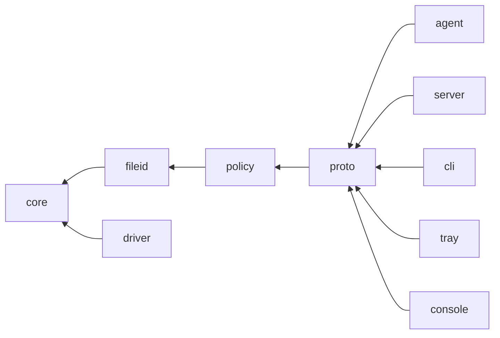

# Crate map

<!-- Generated by `cargo xtask docs generate` from the crate READMEs and xtask/src/deps.rs. Do not edit by hand. -->

The workspace has one crate per component. `cargo xtask check-deps` enforces the allowed dependencies ([ADR 0003](../../../../adr/0003-crate-boundaries-and-dependency-direction.md), [workspace rules](../../../../workspace.md)). How data flows between the components, and across which trust boundaries, is in the [threat model's data-flow diagrams](../../../../security/threat-model.md#data-flow-diagrams).

| Crate | Purpose | May use |
|---|---|---|
| [`palisade-core`](../../../../../crates/palisade-core/README.md) | Shared types for every Palisade crate. It does no I/O, so the kernel driver can reuse it. | no workspace crate |
| [`palisade-fileid`](../../../../../crates/palisade-fileid/README.md) | File identity: PE parsing, hashing (SHA-256, Authenticode, page and flat hashes), signature and certificate chain extraction, version-info metadata, and Windows Installer package identity. | `palisade-core` |
| [`palisade-policy`](../../../../../crates/palisade-policy/README.md) | The policy model, conditions, precedence and evaluation, with a decision trace. Evaluation is pure and deterministic: no network or filesystem access. | `palisade-core`, `palisade-fileid` |
| [`palisade-proto`](../../../../../crates/palisade-proto/README.md) | Wire types between agent and server: messages, the event schema and schema versioning. | `palisade-core`, `palisade-fileid`, `palisade-policy` |
| [`palisade-agent`](../../../../../crates/palisade-agent/README.md) | The Windows endpoint agent: a Windows service that collects execution events, caches policy locally and drives enforcement. | `palisade-core`, `palisade-fileid`, `palisade-policy`, `palisade-proto` |
| [`palisade-server`](../../../../../crates/palisade-server/README.md) | The central management server: policy distribution, approvals, inventory and event storage. | `palisade-core`, `palisade-fileid`, `palisade-policy`, `palisade-proto` |
| [`palisade-cli`](../../../../../crates/palisade-cli/README.md) | The `pal` command-line tool for policy-as-code and administration. | `palisade-core`, `palisade-fileid`, `palisade-policy`, `palisade-proto` |
| [`palisade-tray`](../../../../../crates/palisade-tray/README.md) | The per-session user notifier and request UI that runs in each Windows user session. | `palisade-core`, `palisade-fileid`, `palisade-policy`, `palisade-proto` |
| [`palisade-console`](../../../../../crates/palisade-console/README.md) | The web console frontend and the code that embeds its assets. | `palisade-proto` |
| [`palisade-driver`](../../../../../crates/palisade-driver/README.md) | An optional Windows kernel minifilter for enforcement gaps the OS-native policy formats cannot cover. | `palisade-core` |
| [`xtask`](../../../../../xtask/README.md) | Repository automation for Palisade, run as `cargo xtask <command>` (the alias is in `.cargo/config.toml`). It is a normal workspace crate, so it builds with the pinned toolchain and needs no other tools. | no workspace crate |
