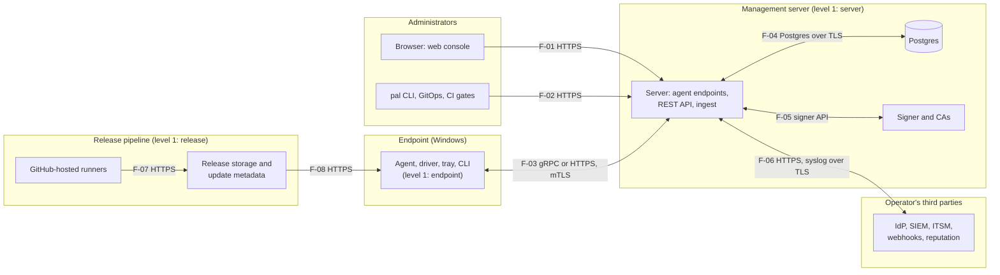
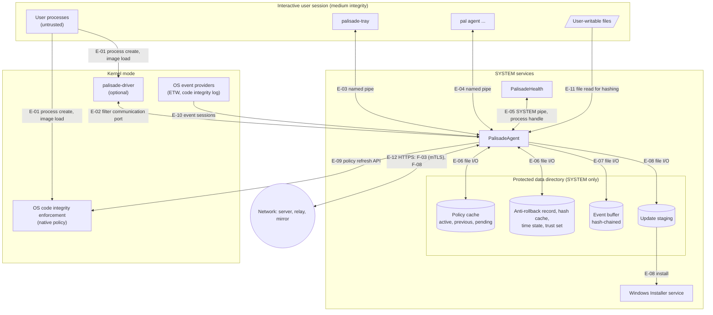
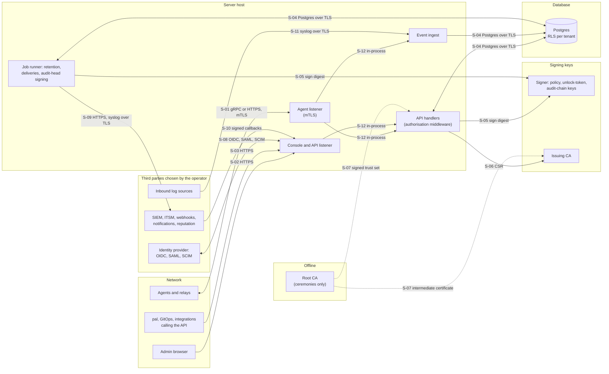
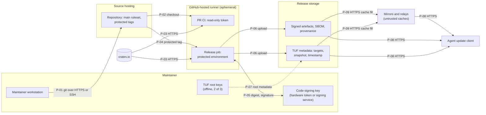
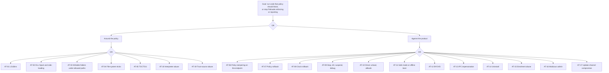
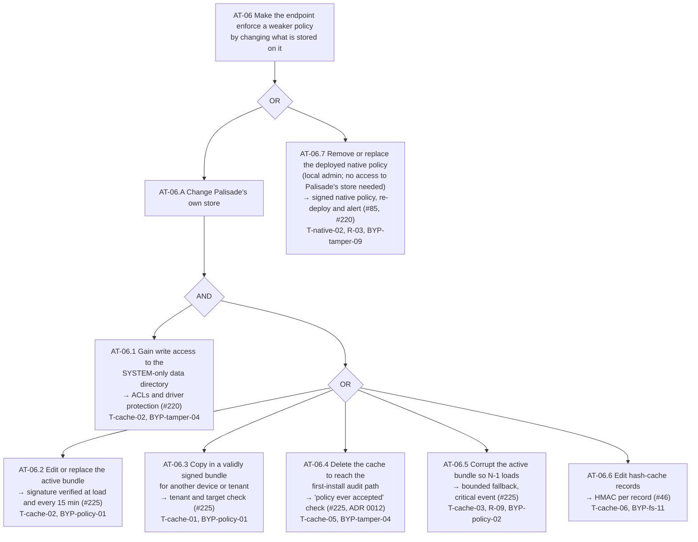

# Palisade threat model and security architecture

| | |
|---|---|
| Document version | 0.1.0 |
| Last reviewed | 2026-11-24 |
| Next review due | 2027-05-24 at the latest (see [Review cadence](#review-cadence)) |
| Status | Draft. The residual-risk register is awaiting review by someone other than the author. |
| Tracking issue | [#219](https://github.com/jusso-dev/palisade/issues/219), under epic [#18](https://github.com/jusso-dev/palisade/issues/18) |

Palisade is an educational, personal-development project and is in the design phase (see the
[README](../../README.md)). Almost every component in this document is still to be built. The
model describes the **planned** design, as fixed by the [ADRs](../adr/README.md) and the GitHub
issues, so that each component can be checked against it while it is built. The status column
says honestly what exists today.

This document is the reference that every child of epic #18 and every enforcement epic (#4, #6,
#7, #8, #9) is checked against. It states what Palisade claims to resist, and just as plainly
what it does not.

## Contents

1. [How to use this document](#how-to-use-this-document)
2. [Scope](#scope)
3. [Method](#method)
4. [System overview](#system-overview)
5. [Assets](#assets)
6. [Actors and claims](#actors-and-claims)
7. [Trust boundaries](#trust-boundaries)
8. [Data-flow diagrams](#data-flow-diagrams)
9. [STRIDE per component](#stride-per-component)
10. [Bypass attack trees](#bypass-attack-trees)
11. [Privacy threats (LINDDUN-lite)](#privacy-threats-linddun-lite)
12. [Mitigation mapping](#mitigation-mapping)
13. [Residual-risk register](#residual-risk-register)
14. [Assumptions](#assumptions)
15. [Process](#process)
16. [Changelog](#changelog)

## How to use this document

- **Threat IDs** have the form `T-<component>-<nn>`, for example `T-agent-03`. They are stable:
  an ID is never renumbered or reused. A threat that no longer applies is marked `retired` in its
  row, with the reason, and stays in the table.
- **Code comments** that implement a mitigation reference the threat: `// threat: T-agent-03`.
  Bypass scenarios in #230 list the threats they test in their `threat_ids` field. Coverage can
  then be found with `git grep 'T-agent-03'`.
- **Issue keys** are GitHub issue numbers in this repository. A mitigation always names at least
  one issue that owns it.
- **Status** has three values:
  - `planned`: the design exists (an ADR or an issue), but there is no code on `main` yet.
  - `implemented`: the mitigation is on `main`, and the verification column names an existing
    test, fuzz target or CI check that exercises it.
  - `verified`: a #230 bypass scenario or a recorded red-team test shows the mitigation holding
    end to end on the Windows VM harness (#26). Nothing is `verified` yet, because the harness
    does not exist yet.
- **Impact and likelihood** are L, M or H. Likelihood assumes the planned mitigation is
  **absent**, so it says how much the mitigation matters. Residual risk is in its own column.
- **When you change Palisade**: if your change adds or moves a trust boundary, adds a parser of
  untrusted input, or changes how a listed mitigation works, update this document in the same
  pull request (see [Process](#process)).

## Scope

### Modelled

Every Palisade component and the paths between them:

- on the endpoint: the optional kernel driver, the agent service, the health and watchdog
  service, the tray notifier, the local CLI, local IPC, the protected local store (policy cache,
  anti-rollback record, hash cache, time state), the event buffer and the update client;
- the OS-native policy layer that Palisade compiles and deploys ([ADR 0002](../adr/0002-enforcement-strategy.md));
- on the server: the agent endpoints, the REST API, the web console, the database, the signer,
  the certificate authorities, event ingest and outbound or inbound integrations;
- the CI and release pipeline, from source to the agent's update client;
- the shared policy engine and file-identity parsers, which every component relies on;
- script and interpreter control (#7), which the interpreter bypass tree depends on.

### Not modelled

- Physical attacks that need special hardware: DMA attacks through external ports, cold-boot
  memory extraction, hardware implants and side channels such as speculative execution.
- Firmware and boot-chain implants below the OS (UEFI implants, a compromised boot manager).
  Secure Boot is an [assumption](#assumptions), not something Palisade enforces.
- Vulnerabilities in Windows itself. An attacker who exploits a kernel bug is treated as the
  kernel-level actor in [Actors and claims](#actors-and-claims), and Palisade does not claim to
  resist them.
- The security of the operator's own identity provider, directory, SIEM, ticketing system or
  hosting platform, beyond how Palisade authenticates to them.
- High-volume denial of service against a deployment, and social engineering of the maintainer
  (both also out of scope in [SECURITY.md](../../SECURITY.md)).
- Formal certification of any kind (#18 lists it as out of scope).

### Assumed OS baseline

- Endpoints: Windows 11, and Windows 10 22H2 only while it still receives security updates.
  Servers: Windows Server 2019 or later. x64 and ARM64.
- Secure Boot is on. Disk encryption with the OS's built-in full-volume encryption and a TPM
  protector is recommended; where it is off, the
  [residual-risk register](#residual-risk-register) applies.
- The full list is in [Assumptions](#assumptions).

## Method

- **STRIDE per element.** Every component has a table that considers Spoofing, Tampering,
  Repudiation, Information disclosure, Denial of service and Elevation of privilege. A category
  that does not apply is written as `N/A` with the reason.
- **Attack trees** for the bypass techniques that are specific to application control. They use
  AND and OR nodes, and every leaf maps to a mitigation, an issue and a verification.
- **LINDDUN-lite** for privacy threats. Its output is shared with #228 (privacy and data
  minimisation).
- **MITRE ATT&CK** technique IDs are given for bypass trees where one fits (ATT&CK is an open
  framework). This answers the open question in #219: the mapping is included, at the level of
  attack-tree roots, and #230 scenarios may carry the same IDs in their `technique` field.

## System overview

The architecture is the one in the [README](../../README.md#architecture-planned) and the ADRs.

| Component | Crate or artefact | Runs as | Decided in |
|---|---|---|---|
| Kernel driver (optional minifilter) | `palisade-driver` | Kernel mode | [ADR 0002](../adr/0002-enforcement-strategy.md), [ADR 0003](../adr/0003-crate-boundaries-and-dependency-direction.md), #8 |
| OS-native policy layer | Compiled by `palisade-policy` and the agent | Enforced by the OS kernel | [ADR 0002](../adr/0002-enforcement-strategy.md), #6 |
| Agent service (`PalisadeAgent`) | `palisade-agent` | LocalSystem service | [ADR 0009](../adr/0009-async-runtime-and-concurrency.md), [ADR 0012](../adr/0012-fail-open-vs-fail-closed-defaults.md), #4 |
| Health and watchdog service (`PalisadeHealth`) | `palisade-agent` | LocalSystem service | #220 |
| Tray notifier | `palisade-tray` | Interactive user, medium integrity | #146 |
| Local CLI | `palisade-cli` (`pal`) | The calling user | #67, #189 |
| Policy cache and protected store | Files under `%ProgramData%\Palisade\` | Owned by SYSTEM | [ADR 0007](../adr/0007-agent-local-store.md), #61, #225 |
| Event buffer | Agent store | Owned by SYSTEM | #63, #220 |
| Update client | `palisade-agent` | LocalSystem | #66, #226 |
| Server API (agent endpoints and REST) | `palisade-server` | Unprivileged service account or container user | [ADR 0005](../adr/0005-agent-server-protocol.md), #126, #185 |
| Web console | `palisade-console` | Administrator's browser | #136 |
| Database | Postgres 16 or later | Separate host or service | [ADR 0006](../adr/0006-server-database.md), #127 |
| Signer | `Signer` trait: file, PKCS#11 or KMS back end | Server host or hardware | [ADR 0008](../adr/0008-cryptographic-algorithms.md), #224 |
| Certificate authorities | Offline root, online issuing CA | Offline machine; server | #224 |
| Event ingest | `palisade-server` | Server | #126, #202, #207 |
| Integrations | `palisade-server` | Server | #16, #188, #198 to #206 |
| CI and release pipeline | `.github/workflows/`, `xtask` | GitHub-hosted runners only | [docs/ci.md](../ci.md), #21, #24, #226 |
| Policy engine and file identity | `palisade-policy`, `palisade-fileid`, `palisade-core` | Inside the agent, server and CLI | [ADR 0003](../adr/0003-crate-boundaries-and-dependency-direction.md), [ADR 0011](../adr/0011-msrv-and-unsafe-code-policy.md) |
| Script and interpreter control | Script-host adapters, AMSI provider, interpreter rules in `palisade-agent` | Inside script hosts and the agent | #7 |

Three design decisions shape the whole model:

1. **The native layer keeps enforcing without the agent** ([ADR 0002](../adr/0002-enforcement-strategy.md),
   [ADR 0012](../adr/0012-fail-open-vs-fail-closed-defaults.md)). Stopping or crashing the agent
   removes reporting and the driver-only rules, not the baseline policy.
2. **Everything the agent trusts is signed end to end** ([ADR 0005](../adr/0005-agent-server-protocol.md),
   [ADR 0008](../adr/0008-cryptographic-algorithms.md)): policy bundles, commands, unlock tokens,
   trust sets and updates. The transport is protected too, but trust never depends on it.
3. **Decisions never wait for the network** ([ADR 0009](../adr/0009-async-runtime-and-concurrency.md)).
   Slowing or blocking the server cannot hang or loosen enforcement.

## Assets

Ratings are for confidentiality (C), integrity (I) and availability (A): H (high), M (medium) or L (low).

| ID | Asset | Where it lives | C | I | A | Why |
|---|---|---|---|---|---|---|
| A-01 | Enforcement correctness (the decision itself) | Driver, native policy, agent evaluator | L | H | H | A wrong allow is a bypass. A wrong deny stops work. The rules are not secret. |
| A-02 | Policy bundles: server-side source and the endpoint cache | Database, signer output, `%ProgramData%\Palisade\` | M | H | H | Policy defines what may run. Read access reveals the gaps an attacker would look for, but Palisade does not depend on policy secrecy. |
| A-03 | Private keys: policy signing, update signing, root CA, issuing CA, unlock token, escrow, audit chain | Signer back end, offline root machine, release signing token | H | H | M | A stolen key lets an attacker sign policy, updates, certificates or unlock tokens for the whole fleet. |
| A-04 | Device identity keys and certificates | CNG key store on the device (TPM where present); certificate in the agent store | H | H | M | A copied key lets an attacker impersonate the device. |
| A-05 | Event and audit logs: the endpoint buffer and the server store | Agent store, database, external log sink | M | H | M | They are the evidence trail (ISM-1815, ISM-1985). Edits hide attacks. |
| A-06 | Exception, override and unlock secrets: device secrets, stop-code hashes, CLI password hashes, unredeemed tokens and codes | Database (escrow), agent store, console session | H | H | M | They switch protection off. |
| A-07 | Admin credentials, API tokens and SSO configuration | Database (hashes, envelope-encrypted secrets), identity provider | H | H | M | They control the management plane and so every endpoint. |
| A-08 | Collected user data: usernames, command lines, file paths | Event buffer, database, SIEM exports | H | M | L | Personal data, sometimes with secrets in command lines (#228). |
| A-09 | Release artefacts and the build pipeline | Repository, GitHub-hosted runners, release storage, update metadata | L | H | M | A tampered release runs as SYSTEM on every endpoint. Artefacts are public by design. |

## Actors and claims

| ID | Actor | Capabilities | Palisade's claim | Goal where not resisted |
|---|---|---|---|---|
| AC-01 | Standard user | Runs programs as themselves; writes to their profile and to user-writable folders; uses the tray and unprivileged CLI verbs. | **Resists fully with the driver present.** Cannot run code that policy blocks, or stop, reconfigure, uninstall or blind Palisade. **Driverless exception:** owner and other driver-only conditions only audit, so a path-plus-owner rule falls back to the broader native path allow; if ACL drift makes an allowed path user-writable, a standard user can run a payload from it (R-07, T-engine-11, AT-03.3). | |
| AC-02 | Malware running as a standard user | As AC-01, plus automation, persistence in the user's profile, and injection into the user's own processes. | **Resists fully with the driver present**, as for AC-01, with the same driverless exception (R-07, T-engine-11, AT-03.3). Phishing a user for a single-use, device-bound unlock token is limited by token scope (T-tray-01). | |
| AC-03 | Local administrator (legitimate) | Full control of the OS configuration; can load drivers, change services, debug processes and boot other media. | **Resists casual tampering without an unlock token**: stopping the service, uninstalling, editing configuration or deleting the cache (#220, #222). A signed native policy on a Secure Boot device resists removal (#85). **Does not resist a determined administrator**, who can disable the driver and then the agent ([ADR 0013](../adr/0013-protected-process-light-feasibility.md)). | Detect and alert: tamper events, heartbeat gaps at the server, binary-integrity failures. |
| AC-04 | Malware with administrator or SYSTEM rights | As AC-03, automated and hostile; can read anything a SYSTEM process can. | **Does not claim to resist.** Listed as residual risk R-01. | Detect and alert. The native layer, especially a signed one, keeps enforcing until the attacker takes further steps. |
| AC-05 | Kernel-level attacker, for example through a vulnerable signed driver (BYOVD) | Arbitrary kernel read and write; can remove callbacks and kill protected processes. | **Does not claim to resist.** The vulnerable driver blocklist (#87) and driver load control (#105) aim to stop the entry point. Residual risk R-02. | Detect and alert where any user-mode or server-side signal survives. |
| AC-06 | Malicious or compromised console administrator | Any action their RBAC role and scope permit, through the console or API. | **Partly resists.** Limited by scoped RBAC (#131), optional four-eyes approval (#142, #229), the mandatory-deny tier no policy can override ([ADR 0004](../adr/0004-default-rule-precedence-model.md)), staged rollout (#135) and audit (#132, #229). An administrator with tenant-wide rights and no dual control can widen policy (R-08). | Audit, alerting and immutable policy history make the change visible and reversible. |
| AC-07 | Network attacker: on-path, or a TLS-inspecting proxy | Reads, drops, delays and modifies traffic; presents certificates from its own CA. | **Resists** for confidentiality and integrity: mTLS with server pinning ([ADR 0005](../adr/0005-agent-server-protocol.md), #223) and end-to-end signatures. **Does not resist** blocking traffic, but enforcement continues offline ([ADR 0009](../adr/0009-async-runtime-and-concurrency.md)). | Offline devices keep their policy; check-in gaps are reported. |
| AC-08 | Compromised management server | Everything the server process can do: use the signer, read the database as the runtime role, talk to every agent. | **Resists** pushing binaries: update metadata is signed by keys not held on the server (#226). **Resists** cross-tenant reads caused by application bugs at the database layer ([ADR 0006](../adr/0006-server-database.md)); `NOBYPASSRLS` and `FORCE ROW LEVEL SECURITY` stop RLS from being disabled. **Does not resist** cross-tenant reads by a process that holds the runtime role, because the server sets the tenant scope itself. **Does not resist** pushing a permissive, validly signed policy unless dual control and hardware-backed signing are in place (R-08). | Signing audit, agents reporting bundle kid and hash, dual control. |
| AC-09 | Compromised dependency or supply chain | Malicious code in a crate, build tool or action. | **Partly resists**: registry and source restrictions, lockfile, advisory scans and SHA-pinned actions (#21, #23). **Does not resist** a malicious release of a crate that is already trusted, before an advisory exists (R-15). | Advisory scan daily; SBOM per release (#226). |
| AC-10 | Compromised CI runner or maintainer account | Run code in CI, push to branches, open and merge pull requests, start a release. | **Partly resists**: ephemeral GitHub-hosted runners, protected tags and release environment, provenance attestations, and an offline threshold root for update metadata (#226). **Does not resist** a fully compromised sole maintainer account (R-14). | Provenance and `pal verify` let anyone check what was built from which commit. |
| AC-11 | Insider with physical access | Boots other media, removes the disk, uses safe mode. | **Partly resists**: safe-mode registration and tamper events (#220). With disk encryption and Secure Boot, offline tampering is impractical. **Does not resist** without disk encryption (R-05). DMA attacks are out of scope. | Binary and cache integrity checks at the next boot. |

## Trust boundaries

| ID | Boundary | What crosses it | Main controls |
|---|---|---|---|
| TB-01 | Kernel mode / user mode | Process and image-load callbacks, file-system I/O, driver communication-port messages, OS event providers | Port DACL and caller check (#110), the OS's own policy enforcement, bounded message handling |
| TB-02 | SYSTEM services / interactive user session | Files, registry keys, services and process handles of the agent; untrusted files the agent reads | ACLs on files, keys and services (#220), driver protection, no path following as SYSTEM (T-agent-13) |
| TB-03 | Local IPC (named pipe) | Requests from the tray and CLI to the agent | Pipe DACL, local clients only, caller verification, schema and size limits (#220) |
| TB-04 | Endpoint / network | Everything the agent sends or receives | mTLS, server pinning, signed payloads (#223, #225, #226) |
| TB-05 | Network / server | Agent, relay, browser, CLI and API traffic arriving at the server | Separate agent and console listeners, TLS, authentication, rate limits (#229) |
| TB-06 | Server / database | Queries and results | TLS, least-privilege roles, RLS ([ADR 0006](../adr/0006-server-database.md), #127) |
| TB-07 | Server / signing keys | Digests to sign, signatures back; CSRs to the issuing CA | Signer back ends, key separation by purpose, audit (#224) |
| TB-08 | Server / third-party integrations | Outbound events, tickets and lookups; inbound SSO, SCIM, callbacks and logs | Per-integration credentials, signed assertions and callbacks, SSRF guard (#204, #229) |
| TB-09 | CI / release storage | Build outputs, signatures, SBOM, provenance and update metadata | Protected tags and environment, provenance, signing outside the build (#226) |
| TB-10 | Release storage / agent | Update metadata and packages fetched by the agent | TUF-style metadata chain, pinned Authenticode publisher, length limits (#226) |
| TB-11 | Release job / code-signing key | Digests to sign, signatures back | Key in a hardware token or signing service, never a repository secret (#226) |
| TB-12 | Maintainer workstation / source hosting | Pushes and pull requests | Two-factor authentication, pull-request-only `main`, required checks ([docs/repo-settings.md](../repo-settings.md)) |
| TB-13 | Source hosting and package registry / CI runner | Source checkouts, crates, workflow triggers | Read-only job token, SHA-pinned actions, lockfile and `cargo deny` source checks ([docs/ci.md](../ci.md), #23) |

TB-11 to TB-13 are additions to the list in #219. Release signing keys sit outside the server,
so they need their own boundary, and the release pipeline diagram needs named boundaries for the
source hosting platform and the package registry.

## Data-flow diagrams

In each diagram, subgraphs are trust zones and an arrow that leaves a subgraph crosses a trust
boundary. Every arrow has a flow ID. A flow that stays inside one zone says "None (same zone)"
in its Boundary column, and names the boundary that the zone's protection enforces, where there
is one. The table under the diagram gives each flow's protocol,
authentication, integrity protection, confidentiality protection and the boundary it crosses.

### Level 0: whole system

| Flow | From → to | Protocol | Authentication | Integrity | Confidentiality | Boundary |
|---|---|---|---|---|---|---|
| F-01 | Browser → console and API | HTTPS, TLS 1.2 or later | SSO (OIDC or SAML) or local account with TOTP; session cookie | TLS; CSRF token on state changes | TLS | TB-05 |
| F-02 | `pal`, GitOps → REST API | HTTPS, TLS 1.2 or later | Scoped, expiring API token or OAuth2 client credentials (#187) | TLS | TLS | TB-05 |
| F-03 | Agent ↔ server (or relay) | gRPC over HTTP/2; HTTPS and JSON fallback ([ADR 0005](../adr/0005-agent-server-protocol.md)) | Mutual: device certificate with a non-exportable key; server pinned against the trust set | TLS, plus end-to-end signatures on bundles, commands and tokens | TLS | TB-04, TB-05 |
| F-04 | Server ↔ database | Postgres wire protocol over TLS | Runtime role credential from a secret source (#227) | TLS | TLS, plus envelope encryption of sensitive columns | TB-06 |
| F-05 | Server ↔ signer and CAs | PKCS#11, KMS API, or in-process for the file back end | HSM PIN or workload identity (#224, #227) | Signatures over domain-separated digests | Only digests and public data cross | TB-07 |
| F-06 | Server ↔ integrations | HTTPS; syslog over TLS; OIDC, SAML, SCIM | Per-integration credentials; signed assertions; signed callbacks | TLS; HMAC-signed webhooks | TLS | TB-08 |
| F-07 | Release job → release storage | HTTPS to the hosting platform's API | Job token in the protected `release` environment | Authenticode, provenance attestation, signed SBOM, TUF metadata | None needed: artefacts are public | TB-09 |
| F-08 | Release storage or mirror → agent | HTTPS | Server authentication only; mirrors are untrusted | TUF metadata chain, hash and length, pinned Authenticode publisher | None needed: artefacts are public | TB-10 |

### Level 1: endpoint

| Flow | From → to | Protocol | Authentication | Integrity | Confidentiality | Boundary |
|---|---|---|---|---|---|---|
| E-01 | User process → kernel (native policy and driver) | System calls: process creation, section mapping | The caller's token, as the OS sees it | Decided by the kernel on the file object being mapped | N/A: no data is returned beyond the verdict | TB-01 |
| E-02 | Driver ↔ agent | Filter communication port | Port DACL (SYSTEM only), single connection, image check of the connecting process (T-driver-01) | Kernel-mediated messages with sequence numbers | Kernel-mediated; no other process can read the port | TB-01 |
| E-03 | Tray ↔ agent | Named pipe `\\.\pipe\palisade-agent`, protobuf messages, remote clients rejected | Agent: client PID, session, token SID by identification-level impersonation, image signature. Tray: checks the pipe server is the signed agent service running as SYSTEM before writing | Schema-validated messages, 64 KiB limit, rate limit | Pipe DACL; local only | TB-02, TB-03 |
| E-04 | CLI ↔ agent | Same pipe | As E-03, plus an unlock token or CLI password for privileged verbs (#222) | As E-03 | As E-03; secrets read from stdin, never from arguments | TB-02, TB-03 |
| E-05 | Health service ↔ agent | SYSTEM-only named pipe and a process-handle wait | Caller verification as E-03 | Schema-validated heartbeat | Pipe DACL (SYSTEM only) | None (same zone) |
| E-06 | Agent ↔ policy cache and state | NTFS file I/O | Directory ACL: SYSTEM only (#220); driver protection when present | Bundle signatures verified on a private copy; HMAC on hash-cache and anti-rollback records ([ADR 0007](../adr/0007-agent-local-store.md)) | Optional AES-256-GCM with a DPAPI- or TPM-wrapped key (#225) | None (same zone); the directory ACL enforces TB-02 against user processes |
| E-07 | Agent → event buffer | NTFS file I/O | As E-06 | HMAC chain; chain head reported at check-in (#220) | As E-06 | None (same zone); as E-06 |
| E-08 | Agent → update staging → installer | NTFS file I/O; Windows Installer | As E-06 | TUF chain and Authenticode publisher verified, then re-verified before installation (#226) | None needed: packages are public | None (same zone); as E-06 |
| E-09 | Agent → OS policy store | The OS's policy refresh interface | Runs as SYSTEM | Signed native policies where configured (#85) | None needed | TB-01 |
| E-10 | OS event providers → agent | ETW sessions and event log API | OS-controlled provider and session security | OS-provided | Local only | TB-01 |
| E-11 | User-writable files → agent | File reads by handle | N/A: untrusted input | Treated as untrusted; parsed by safe Rust with limits ([ADR 0011](../adr/0011-msrv-and-unsafe-code-policy.md)) | N/A | TB-02 |
| E-12 | Agent ↔ network | See F-03 and F-08 | See F-03 and F-08 | See F-03 and F-08 | See F-03 and F-08 | TB-04 |

### Level 1: server

| Flow | From → to | Protocol | Authentication | Integrity | Confidentiality | Boundary |
|---|---|---|---|---|---|---|
| S-01 | Agents and relays ↔ agent listener | gRPC over HTTP/2, HTTPS and JSON fallback, on a separate listener from the console (#229) | Device or relay certificate chained to the issuing CA, serial checked against the database (#223) | TLS; signed payloads | TLS | TB-05 |
| S-02 | Browser → console and API listener | HTTPS | SSO or local account with MFA; `__Host-` session cookie (#229) | TLS; CSRF token | TLS; HSTS | TB-05 |
| S-03 | API clients → API listener | HTTPS | Scoped API token or OAuth2 client credentials (#187) | TLS | TLS | TB-05 |
| S-04 | Server components ↔ database | Postgres wire protocol over TLS | Runtime role (`NOBYPASSRLS`, not the owner); migrations use a separate owner role ([ADR 0006](../adr/0006-server-database.md)) | TLS; append-only audit table | TLS; envelope-encrypted sensitive columns (#227) | TB-06 |
| S-05 | API and jobs → signer | PKCS#11, KMS API or in-process (lab only) | HSM PIN or workload identity from a secret source | Domain-separated digest in, signature out (#225) | Only digests cross | TB-07 |
| S-06 | Enrolment and renewal → issuing CA | In-process or PKCS#11 | As S-05 | CSR with proof of possession; issued certificate | Public data | TB-07 |
| S-07 | Offline root → issuing CA (intermediate certificate) and API (trust set for distribution) | Manual transfer on removable media | Physical custody and ceremony (#224) | Root signature, checked on import | Public data | TB-07 |
| S-08 | Identity provider ↔ server | OIDC authorisation code with PKCE, SAML 2.0, SCIM 2.0 over HTTPS | Client secret; signed assertions; SCIM bearer token | Signed assertions; replay cache; TLS | TLS | TB-08 |
| S-09 | Jobs → outbound integrations | HTTPS; syslog over TLS | Per-integration credentials, envelope-encrypted at rest (#227) | TLS; HMAC-signed webhook bodies (#188) | TLS | TB-08 |
| S-10 | ITSM and approval callbacks → server | HTTPS | Signed callback or single-use link plus re-authentication (#144) | Signature bound to the request ID | TLS | TB-08 |
| S-11 | Inbound log sources → ingest | Syslog over TLS (#207). Plain UDP only if the operator allows it, marked low trust: UDP has no authentication, integrity or confidentiality | TLS: client certificate allowlist. UDP: none | TLS: TLS. UDP: none | TLS: TLS. UDP: none | TB-08 |
| S-12 | Listeners → API handlers and ingest | In-process calls | Identity already established by the listener (certificate, session or token), passed as a typed value | Memory safety of the server process (safe Rust, ADR 0011) | In-process | None (same zone) |

### Level 1: release pipeline

| Flow | From → to | Protocol | Authentication | Integrity | Confidentiality | Boundary |
|---|---|---|---|---|---|---|
| P-01 | Maintainer → repository | Git over HTTPS or SSH | Account with two-factor authentication; pull requests only on `main` ([docs/repo-settings.md](../repo-settings.md)) | Required checks; signed commits recommended (#226) | None needed: public repository | TB-12 |
| P-02 | Repository → PR CI | Checkout at a commit SHA | Read-only job token; no secrets for fork pull requests; `persist-credentials: false` | Commit SHA; actions pinned by SHA ([docs/ci.md](../ci.md)) | None needed | TB-13 |
| P-03 | Registry → runner | HTTPS | Registry server certificate | `Cargo.lock` checksums; `cargo deny` source and advisory checks (#23) | None needed | TB-13 |
| P-04 | Protected tag → release job | Workflow trigger | Required reviewers on the `release` environment (#226) | Tag protection; provenance records the commit | None needed | TB-13 |
| P-05 | Release job ↔ code-signing key | Signing service API or hardware token | Signing service credentials scoped to the release environment, or token PIN | Hash of the artefact checked before signing | Only digests cross | TB-11 |
| P-06 | Release job → release storage | HTTPS to the hosting platform | Job token with write access, only in the release environment | Authenticode with RFC 3161 timestamp, build provenance, signed SBOM, TUF targets (#226) | None needed: public | TB-09 |
| P-07 | TUF root keys → metadata | Offline signing, manual upload | Threshold of 2 of 3 maintainer keys | Root signatures | None needed | TB-09 |
| P-08 | Storage or mirror → agent: metadata and packages | HTTPS | Server authentication only; mirrors are untrusted | Full TUF chain, version monotonicity, expiry, length and hash, pinned publisher (#226) | None needed | TB-10 |
| P-09 | Release storage → mirrors and relays | HTTPS | Server authentication only | None relied on: mirrors are untrusted caches, and the agent verifies everything (P-08) | None needed | TB-10 (mirrors are outside release storage) |

## STRIDE per component

Every component has a row for each of the six STRIDE categories, and some have more than one.
Mitigations and verification are listed per threat in [Mitigation mapping](#mitigation-mapping).
Every attack-tree leaf below names at least one of these threats, so each bypass technique also
has a row in the mitigation table.

Summary by status:

| Component | Threats | Planned | Implemented | Verified |
|---|---|---|---|---|
| `driver` | 10 | 10 | 0 | 0 |
| `native` | 7 | 7 | 0 | 0 |
| `agent` | 17 | 17 | 0 | 0 |
| `health` | 6 | 6 | 0 | 0 |
| `tray` | 7 | 7 | 0 | 0 |
| `cli` | 8 | 8 | 0 | 0 |
| `cache` | 11 | 11 | 0 | 0 |
| `events` | 7 | 7 | 0 | 0 |
| `update` | 8 | 8 | 0 | 0 |
| `api` | 11 | 11 | 0 | 0 |
| `console` | 10 | 10 | 0 | 0 |
| `db` | 8 | 8 | 0 | 0 |
| `signer` | 6 | 6 | 0 | 0 |
| `ca` | 7 | 7 | 0 | 0 |
| `ingest` | 8 | 8 | 0 | 0 |
| `integ` | 10 | 10 | 0 | 0 |
| `script` | 8 | 8 | 0 | 0 |
| `ci` | 11 | 7 | 4 | 0 |
| `engine` | 13 | 10 | 3 | 0 |
| **Total** | **173** | **166** | **7** | **0** |

### Kernel driver (`palisade-driver`, optional minifilter)

Pre-execution decisions for the conditions the OS-native policy cannot express (ADR 0002). Optional; absent until #8 ships.

| ID | STRIDE | Threat | Preconditions | Impact | Likelihood | Mitigation issue | Status | Residual risk |
|---|---|---|---|---|---|---|---|---|
| T-driver-01 | S | A process other than the agent connects to the driver's communication port and sends verdicts or configuration. | Code execution on the endpoint | H | M | #110, #220 | planned | A SYSTEM attacker that can inject into the agent can still speak for it (see R-01). |
| T-driver-02 | T | Driver binary, service key, altitude or instance configuration is changed so the driver does not load or loads below other filters. | Local admin | H | M | #110, #113, #220 | planned | Offline edits (safe mode, another boot medium) are not prevented; detected at next boot (R-05). |
| T-driver-03 | T | Another filter is registered at a higher altitude and rewrites or hides I/O before the Palisade filter sees it. | Admin able to load a signed driver | H | L | #105, #110 | planned | Any signed kernel code can do this; that is a kernel-level attacker (R-02). |
| T-driver-04 | R | A block or allow decided in the kernel leaves no record, for example while the agent is disconnected. | Agent disconnected or slow | M | M | #110, #63 | planned | Events can be lost if the ring buffer overflows; the gap itself is reported. |
| T-driver-05 | I | Port messages expose data (command lines, file paths of other users) to a process that should not see them. | Access to the communication port | M | L | #110, #228 | planned | None beyond T-driver-01. |
| T-driver-06 | D | A crafted path, reparse-point loop or very long name makes the driver hang or stop the machine, possibly on every boot. | Standard user can create files | H | M | #110, #113, #230 | planned | A kernel bug is always possible; recovery keeps the machine usable. |
| T-driver-07 | D | The attacker slows the agent (exec flood, large files) so driver requests time out and `fail_safe` lets driver-only rules lapse. | Code execution as a standard user | M | M | #113, #42, #65 | planned | With the default `fail_safe`, driver-only rules are not enforced while the agent is unresponsive (R-07). The native layer keeps enforcing. |
| T-driver-08 | E | A memory-safety bug in the driver's message or I/O handling gives kernel code execution. | Access to file-system callbacks (any user) or to the port (SYSTEM) | H | L | #110, #230 | planned | The driver is the one crate where unsafe code is pervasive (ADR 0011). |
| T-driver-09 | T | An executable's content changes between the moment it is hashed and the moment its image section is mapped, so the code that runs is not the code that was checked. | Write access to the file, for example in a user-writable folder | H | M | #110, #111, #46, #60 | planned | Until the driver ships, the native layer's own section-time check is the only defence for this race (R-07). |
| T-driver-10 | E | A known vulnerable signed driver is loaded to gain kernel code execution and remove Palisade's callbacks or kill the agent (BYOVD). | Administrator rights to load a driver | H | M | #87, #105 | planned | Kernel code is fully trusted; unknown vulnerable drivers and kernel exploits are not stopped (R-02). |

### OS-native policy layer (compiled code integrity and rule-collection policies)

The kernel-enforced baseline from ADR 0002. Not a Palisade process, but Palisade generates, deploys and depends on it.

| ID | STRIDE | Threat | Preconditions | Impact | Likelihood | Mitigation issue | Status | Residual risk |
|---|---|---|---|---|---|---|---|---|
| T-native-01 | S | An attacker deploys their own supplemental policy that adds allow rules on top of the Palisade base policy. | Local admin | H | M | #83, #85 | planned | Unsigned base policies cannot prevent this (R-03). |
| T-native-02 | T | An administrator deletes or replaces an unsigned native policy file, or turns off the legacy rule-collection service. | Local admin | H | M | #85, #220 | planned | Unsigned OS-native policies can always be removed by an administrator; only signed policies with Secure Boot resist (R-03). Per-user rules depend on a service an admin can stop (R-04). |
| T-native-03 | R | Native block events are not collected, so a block or an audit hit has no record. | Event log channel disabled or cleared | M | M | #58, #220 | planned | Events raised while the channel was off are lost. |
| T-native-04 | I | N/A: Compiled policies describe what is allowed, and an attacker who reads them learns the gaps. Palisade never relies on policy secrecy, so this is not treated as a threat. Server-side secrets never enter native policies. | | | | | | |
| T-native-05 | D | A bad policy blocks boot-critical drivers or the OS's own components, so the device cannot boot. | Policy author mistake, or a malicious admin | H | M | #91, #135 | planned | A policy that passes the linter can still break a rare device. |
| T-native-06 | E | Code runs despite policy through signing-level edge cases or a script host that does not enforce code integrity. | Standard user | H | M | #87, #93, #230 | planned | New unenlightened hosts appear over time. |
| T-native-07 | E | A signed OS binary that can run arbitrary code (a LOLBin: mshta, msbuild, installutil, regsvr32, rundll32, cscript, wscript, wmic, certutil and similar) is allowed by a publisher rule and used as a proxy. | Standard user | H | H | #87, #100, #93, #39 | planned | New proxy binaries appear over time (R-16). |
| T-native-08 | E | An allowed executable loads an attacker DLL: side-loaded beside a copy of the executable in a writable folder, or found earlier in the DLL search order (current directory, a user-writable `PATH` entry, a missing DLL). | Standard user can write to a folder the loader searches | H | H | #104, #8, #191, #212 | planned | Until DLL enforcement is on, only executables are checked. |

### Agent service (`palisade-agent`, `PalisadeAgent`)

LocalSystem service: event collection, inventory, policy cache, native policy deployment, driver glue, IPC server (#4, #56).

| ID | STRIDE | Threat | Preconditions | Impact | Likelihood | Mitigation issue | Status | Residual risk |
|---|---|---|---|---|---|---|---|---|
| T-agent-01 | S | A rogue server (DNS hijack, on-path attacker, inspecting proxy) answers check-ins and pushes policy or commands. | Network position between agent and server | H | L | #223, #225 | planned | A compromised real server is a different actor (T-signer-01, R-08). |
| T-agent-02 | S | A process that is not the tray or the signed CLI calls a privileged IPC verb. | Code execution in a user session | H | M | #220 | planned | A SYSTEM attacker can inject into a signed caller (R-01). |
| T-agent-03 | S | The verified caller exits and its PID is reused by an attacker process between verification and the request. | Code execution in a user session | M | L | #220 | planned | None known. |
| T-agent-04 | T | Agent binaries or DLLs in the install directory are replaced, or a DLL is planted beside them. | Local admin | H | M | #220 | planned | Without the driver an admin can still replace files; detection and restore follow (R-01). |
| T-agent-05 | T | Agent registry configuration, service keys, the debugger value under image execution options, or silent-process-exit keys are edited. | Local admin | H | M | #220 | planned | Without the driver, edits are reverted after the fact, not prevented. |
| T-agent-06 | T | Code is injected into the agent process or its memory is written (remote thread, memory write, handle duplication). | Local admin with debug privilege | H | M | #220, #221 | planned | Without the driver or protected process light, an admin can inject (R-01, R-06). |
| T-agent-07 | R | Privileged local actions (unlock token use, tamper level change, diagnostics) happen without a record. | Any privileged local action | M | M | #220, #222 | planned | Records made just before a SYSTEM attacker takes over can be suppressed if not yet uploaded (T-events-03). |
| T-agent-08 | I | Unprivileged IPC verbs reveal policy content, other users' activity or exception details to a standard user. | Standard user | M | M | #220, #228 | planned | The block message itself tells the user what was blocked; that is intended. |
| T-agent-09 | I | A crash dump of the agent contains device secrets, unlock tokens or CLI passwords. | Admin can read dumps | H | L | #227 | planned | Secrets in registers or stack at crash time. |
| T-agent-10 | D | The service is stopped, killed or suspended. | Local admin (standard users cannot reach the service) | M | M | #220, #221 | planned | SYSTEM can stop any user-mode service (R-01, R-06). Stopping the agent removes reporting and driver-only rules, not the native baseline (ADR 0012). |
| T-agent-11 | D | A standard user floods process creation or writes very large files to exhaust CPU, memory or the hashing pool. | Standard user | M | M | #65, #42 | planned | Heavy load can delay reporting. |
| T-agent-12 | D | A crafted file triggers a parser panic on every scan, blinding the agent in a loop. | Standard user can drop files | M | M | #45, #230 | planned | A panic that unwinding cannot catch (stack overflow) restarts the service (ADR 0012 row 1). |
| T-agent-13 | E | The agent, running as SYSTEM, follows a junction or symbolic link planted by a user while hashing, inventorying or writing output, and reads or writes a protected file. | Standard user can create links in a scanned path | H | M | #54, #60, #220 | planned | New file-system redirection primitives appear over time. |
| T-agent-14 | E | A memory-safety bug in the IPC or bundle decoder gives code execution as SYSTEM. | Access to the pipe (any interactive user) | H | L | #220, #230 | planned | Bugs in third-party decoders (protobuf) are tracked by the advisory scan (#23). |
| T-agent-15 | T | The wall clock or the time source is changed to start a scheduled grant early, extend it, or revive an expired exception, token or window. | Local admin, a spoofed time source, or physical access | M | M | #220, #222, #225 | planned | A genuine, unredeemed override code or token can be redeemed outside its window, and opt-in offline scheduling can be stretched until the next check-in (R-10). |
| T-agent-16 | T | Palisade is tampered with while it is not running: in safe mode, from other boot media, or by changing the boot configuration to allow unsigned drivers. | Local admin or physical access | H | M | #220, #210 | planned | Without disk encryption, offline edits cannot be prevented (R-05). |
| T-agent-17 | T | The agent is uninstalled through the installer (`msiexec /x`) or the OS's installed-apps settings page without authorisation. | Local admin | H | H | #222 | planned | SYSTEM can remove the services and files by other means (R-01). |

### Health and watchdog service (`PalisadeHealth`)

LocalSystem service that monitors and repairs the agent, and is monitored by it (#220).

| ID | STRIDE | Threat | Preconditions | Impact | Likelihood | Mitigation issue | Status | Residual risk |
|---|---|---|---|---|---|---|---|---|
| T-health-01 | S | The attacker stops the agent and answers the watchdog's heartbeat in its place. | Local admin | M | L | #220 | planned | A SYSTEM attacker can impersonate either side (R-01). |
| T-health-02 | T | The watchdog's binary or service configuration is changed so it stops repairing the agent. | Local admin | M | M | #220 | planned | As T-agent-04. |
| T-health-03 | T | The protected backup copy used for repair is replaced, so a repair installs attacker code as SYSTEM. | Local admin | H | L | #220 | planned | None if signatures are checked before every restore. |
| T-health-04 | R | The watchdog revives or repairs the agent without a record, so an administrator can deny having stopped it. | Any revival | L | M | #220 | planned | None. |
| T-health-05 | I | N/A: The watchdog holds no secrets and no user data. Its only output is health state, which the agent also reports. | | | | | | |
| T-health-06 | D | Both services are killed at once so neither can restart the other. | Local admin with debug privilege | M | M | #220 | planned | SYSTEM can do this (R-01). The native layer keeps enforcing. |
| T-health-07 | E | The repair path re-registers services or re-applies ACLs from attacker-influenced input. | Local admin | H | L | #220 | planned | None known. |

### Tray notifier (`palisade-tray`)

Per-session, unprivileged user interface: block messages, requests, token entry (#146).

| ID | STRIDE | Threat | Preconditions | Impact | Likelihood | Mitigation issue | Status | Residual risk |
|---|---|---|---|---|---|---|---|---|
| T-tray-01 | S | User-level malware shows a fake Palisade prompt to collect unlock codes, override codes or passwords. | Malware in the user session | M | M | #146, #222 | planned | Social engineering cannot be fully prevented. |
| T-tray-02 | S | Malware creates the agent's pipe name first (pipe squatting), so the tray talks to the attacker. | Code execution in a user session | M | M | #220 | planned | None if both sides check. |
| T-tray-03 | T | Same-user malware tampers with the tray process or its messages. | Malware in the user session | L | H | #146, #220 | planned | The user can be shown false information in their own session. |
| T-tray-04 | R | A user denies having submitted a request or justification. | Any request | L | M | #140 | planned | A shared session (kiosk) cannot attribute to a person. |
| T-tray-05 | I | On a multi-session host the tray shows one user's blocked items or requests to another. | Multi-session host | M | M | #228, #68 | planned | None. |
| T-tray-06 | D | Malware kills the tray, so the user sees no block messages. | Malware in the user session | L | M | #146 | planned | The user loses notifications until the next logon. |
| T-tray-07 | E | The tray becomes a route to elevation (it runs elevated, or exposes an elevated action). | Standard user | H | L | #146, #149 | planned | None known. |

### Local admin CLI (`pal agent ...`)

The `pal` binary used on the endpoint for diagnostics and break-glass actions (#67, #189, #222).

| ID | STRIDE | Threat | Preconditions | Impact | Likelihood | Mitigation issue | Status | Residual risk |
|---|---|---|---|---|---|---|---|---|
| T-cli-01 | S | The CLI password is guessed by brute force. | Standard user or local admin | H | M | #222 | planned | A weak password chosen by an admin (policy enforces length and classes). |
| T-cli-02 | S | A modified or unsigned copy of `pal` calls privileged verbs. | Code execution on the endpoint | H | M | #220 | planned | As T-agent-02. |
| T-cli-03 | T | Malware puts a fake `pal` earlier on the user's `PATH` to capture the CLI password or a token. | Malware in the user session | M | M | #222, #227 | planned | A captured password works until rotated; tokens are single-use. |
| T-cli-04 | R | A local admin unlocks the agent with the CLI and then denies it. | Local admin | M | M | #222 | planned | None. |
| T-cli-05 | I | Secrets passed as command-line arguments appear in process listings and in collected command lines. | Any user who can list processes | M | M | #227, #228 | planned | None if the CLI refuses arguments. |
| T-cli-06 | I | A support bundle leaks configuration, secrets or user data. | Whoever receives the bundle | M | M | #227 | planned | Redaction patterns can miss a new secret format. |
| T-cli-07 | D | A standard user deliberately fails logins to lock admins out of the CLI. | Standard user | L | M | #222 | planned | Local break-glass is delayed during a lockout. |
| T-cli-08 | E | A privileged verb makes the agent write or read a caller-chosen path as SYSTEM. | Caller with a valid token | H | L | #220 | planned | None known. |

### Policy cache and protected local store

Signed bundles `active`, `previous` and `pending` (ADR 0007), the anti-rollback record, the hash cache, and time-rule state (ADR 0012).

| ID | STRIDE | Threat | Preconditions | Impact | Likelihood | Mitigation issue | Status | Residual risk |
|---|---|---|---|---|---|---|---|---|
| T-cache-01 | S | A forged bundle is written into the cache. | SYSTEM, or a gap in the directory ACL | H | L | #225 | planned | None: verification does not depend on file permissions. |
| T-cache-02 | T | The active bundle is edited, replaced or deleted. | SYSTEM | H | L | #225, #220 | planned | Deleting both bundles moves the device to the stricter emergency policy, not to allow-all (ADR 0012). |
| T-cache-03 | T | An older, more permissive but validly signed bundle is replayed. | Write access to the cache or a network position | H | M | #225 | planned | The one-step N-1 fallback is a bounded exception (R-09). |
| T-cache-04 | T | The bundle changes on disk between signature check and parsing. | Write access to the cache | H | L | #61 | planned | None. |
| T-cache-05 | T | The anti-rollback record and caches are deleted to put the device back on the first-install audit path. | SYSTEM | H | L | #225 | planned | A SYSTEM attacker that removes every copy and the registry mirror can reach the first-install path (R-09). |
| T-cache-06 | T | A hash cache record is edited so a file's cached hash matches an allowed hash. | SYSTEM | H | L | #46 | planned | An attacker who can read the agent's MAC key can forge records (R-01). |
| T-cache-07 | T | Time-rule state (floor, redeemed-code list, skew latch, override budget) is reset so a grant or code is revived. | SYSTEM, or offline access | M | L | #220, #222 | planned | See R-10 for the accepted clock risks. |
| T-cache-08 | R | Cache changes cannot be tied to an actor. | Any change | L | M | #220 | planned | Without the driver the actor process is not always known. |
| T-cache-09 | I | An offline or administrator read of the store reveals policy, exceptions or hashed secrets that can be attacked offline. | Admin, or offline disk access | M | M | #220, #225, #222 | planned | SYSTEM can always read the decrypted state (R-01); offline reads need disk encryption (R-05). |
| T-cache-10 | D | The cache is corrupted so the device falls to the emergency policy and business applications stop. | SYSTEM | M | L | #225 | planned | Accepted: the closed direction is intentional (ADR 0012). |
| T-cache-11 | E | A bug in the bundle decoder gives code execution in the agent. | Ability to get bytes into the cache | H | L | #225, #230 | planned | Only signed input reaches the full decoder; the envelope parser sees unsigned bytes. |

### Endpoint event buffer and local log channel

Queued events awaiting upload, hash-chained (#220, #63), and the `Palisade/Operational` channel.

| ID | STRIDE | Threat | Preconditions | Impact | Likelihood | Mitigation issue | Status | Residual risk |
|---|---|---|---|---|---|---|---|---|
| T-events-01 | S | A user writes fake events to the local log channel to mislead an investigator. | Standard user | L | M | #220 | planned | None: the local channel is a convenience copy. |
| T-events-02 | T | Queued events are edited or deleted before upload to hide activity. | SYSTEM | H | L | #220 | planned | A SYSTEM attacker holding the chain key can rewrite the part of the chain not yet reported (R-01). |
| T-events-03 | T | The unreported tail of the chain is dropped (for example by cutting power or the network before upload). | SYSTEM, or control of the network | M | M | #220, #197 | planned | Unreported events after the last check-in can be lost without detection: a SYSTEM attacker can delete them and roll the local sequence back, leaving no gap in the server's view. A gap is visible only when deleted events were already partly reported (R-17). |
| T-events-04 | R | An event lacks the user, process or policy version needed to attribute it. | Any event | M | M | #196, #63 | planned | Pseudonymised usernames need re-identification (#228). |
| T-events-05 | I | Buffered events contain command lines, usernames and paths readable by administrators or offline. | Admin, or offline access | M | M | #228, #220, #225 | planned | SYSTEM reads all (R-01). |
| T-events-06 | D | A flood of low-value events evicts important ones or fills the disk while offline. | Standard user | M | M | #63, #197 | planned | Long offline periods can drop low-priority events; the drop count is reported. |
| T-events-07 | D | The Security or Palisade log channel is cleared. | Local admin | M | M | #220 | planned | Events in the cleared channel are lost; the buffer copy survives. |
| T-events-08 | E | N/A: The buffer is data, not code. The agent decodes only its own records; the server-side decoder is covered by T-ingest-03. | | | | | | |

### Update client

Agent self-update: metadata check, download, verify, stage, install, health check, roll back (#66, #226).

| ID | STRIDE | Threat | Preconditions | Impact | Likelihood | Mitigation issue | Status | Residual risk |
|---|---|---|---|---|---|---|---|---|
| T-update-01 | S | A malicious server, relay or mirror serves a malicious binary as an update. | Control of a server, relay or mirror | H | M | #226 | planned | A compromise of the release signing and TUF root keys together (R-11). |
| T-update-02 | T | Old signed metadata is replayed to roll the agent back to a vulnerable version. | Network position or mirror control | H | M | #226 | planned | None. |
| T-update-03 | T | Metadata is withheld (freeze attack) to keep the device on a vulnerable version. | Network position or mirror control | M | M | #226 | planned | Devices stay on the current version until reachable. |
| T-update-04 | T | The staged package is swapped between verification and installation. | Write access to the staging directory | H | L | #226, #220 | planned | None if the install reads the verified copy. |
| T-update-05 | R | An update is installed without a record. | Any update | L | L | #66 | planned | None. |
| T-update-06 | I | N/A: Release artefacts and update metadata are public by design. The only device data sent is the version, which check-in also reports. | | | | | | |
| T-update-07 | D | An endless or oversized download exhausts disk or bandwidth. | Mirror control | M | L | #226 | planned | None known. |
| T-update-08 | D | A faulty release breaks agents across the fleet. | A bad release | H | M | #226, #66 | planned | The first ring can be affected. |
| T-update-09 | E | The installer runs as SYSTEM with an attacker-chosen package or custom action. | Ability to influence the package path | H | L | #226, #57 | planned | None if only verified packages from the protected directory run. |

### Server API (agent endpoints and REST API)

gRPC and HTTPS fallback agent endpoints (ADR 0005), and the REST API used by the console, `pal` and integrations (#126, #185).

| ID | STRIDE | Threat | Preconditions | Impact | Likelihood | Mitigation issue | Status | Residual risk |
|---|---|---|---|---|---|---|---|---|
| T-api-01 | S | A stolen device certificate and key are used to impersonate a real device. | Admin or SYSTEM on that device, or a cloned image | M | M | #223 | planned | A software-protected key on a device without a TPM can be copied by SYSTEM (R-12). |
| T-api-02 | S | A leaked registration code is used to enrol a rogue device into a tenant. | Possession of a code | M | M | #223 | planned | A valid code used inside its allowed network range enrols a device; it still receives only the policy of its group. |
| T-api-03 | S | An admin API token is stolen and replayed. | Token disclosure | H | M | #187, #227, #229 | planned | A token is usable until it expires or is revoked. |
| T-api-04 | T | A caller reads or changes another tenant's or another group's objects (IDOR, missing scope check). | Any authenticated caller | H | M | #229, #127 | planned | A bug in the scope resolver itself would affect every handler. |
| T-api-05 | T | Unknown or extra request fields change protected attributes (mass assignment). | Any authenticated caller | M | M | #229 | planned | None. |
| T-api-06 | R | An administrator denies an API action. | Any admin action | M | M | #229, #132 | planned | A DB-level attacker can try to rewrite the chain (T-db-02). |
| T-api-07 | I | Responses leak secrets or more data than the caller's role allows (stop-code hashes, tokens, other tenants). | Any authenticated caller | H | M | #222, #227, #229 | planned | None. |
| T-api-08 | D | Check-in, enrolment or API floods overload the server. | Network access to the server | M | M | #229, #223, #62 | planned | A large distributed flood is out of scope (SECURITY.md). |
| T-api-09 | D | Crafted input (deep YAML, huge policy, catastrophic regex) consumes CPU or memory. | Authenticated caller, or anyone who can submit policy | M | M | #190, #229 | planned | The server does not exist yet. The YAML limits are in place (T-engine-08); upload size and regex length caps come with #229. |
| T-api-10 | E | A user grants themselves or others permissions they do not hold. | Authenticated admin with some permissions | H | M | #131, #229 | planned | None. |
| T-api-11 | E | SQL injection reaches the database. | Any caller | H | L | #127, #229 | planned | None. |

### Web console (`palisade-console`)

Browser front end for administrators and approvers (#136, #130).

| ID | STRIDE | Threat | Preconditions | Impact | Likelihood | Mitigation issue | Status | Residual risk |
|---|---|---|---|---|---|---|---|---|
| T-console-01 | S | Admin credentials are phished or stuffed. | Internet access to the console | H | M | #130, #229 | planned | SSO-only mode moves this risk to the identity provider. |
| T-console-02 | S | A session cookie is stolen and reused. | Script injection or a compromised browser | H | L | #229 | planned | Malware on the admin's own machine can act inside the session. |
| T-console-03 | T | A cross-site request changes policy while an admin is logged in. | Admin visits an attacker page | H | L | #229 | planned | None. |
| T-console-04 | T | Stored script injection through endpoint-supplied data (file names, version strings, command lines, request justifications) runs in an admin's browser. | Code execution on any managed endpoint | H | M | #229 | planned | A bug in the UI framework's encoding. |
| T-console-05 | T | The console is framed to trick an admin into clicks (clickjacking). | Admin visits an attacker page | M | L | #229 | planned | None. |
| T-console-06 | R | Shared accounts make console actions unattributable. | Shared credentials | M | M | #229, #130 | planned | Break-glass accounts are shared by nature; each use alerts. |
| T-console-07 | I | An admin sees data outside their tenant or group scope. | Authenticated admin | M | M | #131, #127 | planned | None. |
| T-console-08 | D | An attacker locks admin accounts by failing logins. | Knowledge of usernames | M | M | #229 | planned | Lockout is a trade-off against brute force. |
| T-console-09 | E | A malicious or compromised console admin pushes an allow-all policy, switches groups to audit or deletes blocklists. | Valid admin session | H | M | #142, #229, #133, #135 | planned | Without dual control, one admin can widen policy for every endpoint they manage (R-08). |
| T-console-10 | E | Support access or template tenants are abused to reach another tenant. | Support or template role | H | L | #128 | planned | None known. |

### Server database (Postgres)

Policies, devices, events, approvals, admin audit (ADR 0006, #127).

| ID | STRIDE | Threat | Preconditions | Impact | Likelihood | Mitigation issue | Status | Residual risk |
|---|---|---|---|---|---|---|---|---|
| T-db-01 | S | The server connects to a rogue database or sends credentials in clear. | Network position between server and database | H | L | #227 | planned | None in production mode. |
| T-db-02 | T | Someone with database access rewrites or deletes admin audit records. | Database credentials | H | L | #229 | planned | The database owner role can drop the trigger; the exported, signed chain head still reveals the change. |
| T-db-03 | T | Policy rows are inserted directly into the database so the server signs and distributes them. | Runtime database role | H | L | #229, #133 | planned | A database-level attacker with the runtime role can change what the server signs (R-08). |
| T-db-04 | R | Changes made directly in the database bypass the application audit. | Database credentials | M | L | #229 | planned | Detection only. |
| T-db-05 | I | A database dump or backup exposes secrets or personal data. | Access to backups | H | M | #227, #228 | planned | Personal data in events is readable to anyone with the dump unless pseudonymised. |
| T-db-06 | I | A query without a tenant filter returns another tenant's rows. | Bug in a handler | H | M | #127 | planned | None: RLS is the control, not the filter. |
| T-db-07 | D | Event tables grow until storage is exhausted. | High event volume | M | M | #127, #228, #138 | planned | None if retention is set. |
| T-db-08 | E | The runtime role disables RLS or alters tables. | Compromised server process | H | L | #127, #227 | planned | The owner role's secret must be kept off the runtime host. |

### Signer (policy, unlock-token and audit-chain keys)

The `Signer` interface with file, PKCS#11 and KMS back ends (#224).

| ID | STRIDE | Threat | Preconditions | Impact | Likelihood | Mitigation issue | Status | Residual risk |
|---|---|---|---|---|---|---|---|---|
| T-signer-01 | S | A compromised server process uses the signer as an oracle to sign a permissive bundle or an unlock token. | Code execution on the server | H | L | #224, #142, #229 | planned | A non-exportable key does not stop oracle use (R-08). |
| T-signer-02 | T | A signature made for one purpose is replayed as another (an unlock token accepted as a bundle). | Any valid signature | H | L | #225, #222 | planned | None. |
| T-signer-03 | R | Signing operations are not recorded, so a malicious signature cannot be traced. | Any signing | M | M | #224 | planned | None. |
| T-signer-04 | I | A private key is extracted from disk or memory. | Server host access | H | M | #224, #227 | planned | The file back end is for labs; it warns in production mode. |
| T-signer-05 | D | The signer is unavailable, so no new bundles or tokens can be issued. | Outage of the signer | M | L | #138 | planned | Break-glass then depends on offline daily codes (#222). |
| T-signer-06 | E | A key is used beyond its purpose, for example the policy key signing a trust set. | Server compromise | H | L | #224 | planned | None. |

### Certificate authorities (offline root, online issuing CA)

Device and relay certificates, and trust-set manifests (#224).

| ID | STRIDE | Threat | Preconditions | Impact | Likelihood | Mitigation issue | Status | Residual risk |
|---|---|---|---|---|---|---|---|---|
| T-ca-01 | S | A certificate is mis-issued for the server name, enabling interception of agent traffic. | Issuing CA misuse | H | L | #224, #223 | planned | None if pins are on SPKI, not just the CA. |
| T-ca-02 | T | The issuing CA key is compromised and used to mint device or relay certificates. | Issuing CA host compromise | H | L | #224, #223 | planned | A fake relay could receive events until the CA is rotated; payloads stay end-to-end signed. |
| T-ca-03 | T | The offline root key is compromised. | Theft of the root key | H | L | #224 | planned | There is no clean recovery: devices must be re-enrolled with a new pin (R-11). |
| T-ca-04 | R | Issuance is not recorded. | Any issuance | M | L | #224 | planned | None. |
| T-ca-05 | I | With TLS 1.2, client certificates (device and tenant IDs) are visible to a passive observer. | Passive network observer | L | M | #223 | planned | TLS 1.2 deployments expose device identifiers on the wire. |
| T-ca-06 | D | The CA is unavailable, so certificates expire and devices cannot connect. | CA outage | M | L | #224, #223 | planned | Expired devices keep enforcing but stop reporting. |
| T-ca-07 | E | A device certificate carries extra key usages and is used to pose as a relay or server. | A device certificate | M | L | #223 | planned | None. |

### Event ingest (agent events and inbound log sources)

Server-side reception of agent events (#126, #202) and of OS-native, Security log and syslog events (#207).

| ID | STRIDE | Threat | Preconditions | Impact | Likelihood | Mitigation issue | Status | Residual risk |
|---|---|---|---|---|---|---|---|---|
| T-ingest-01 | S | A device submits events claiming to come from another device. | Any enrolled device | M | M | #126, #223 | planned | None. |
| T-ingest-02 | S | Inbound syslog is spoofed. | Network access to the syslog listener | M | M | #207 | planned | Plain UDP syslog cannot be authenticated; such sources are marked as low trust. |
| T-ingest-03 | T | Malformed events (huge fields, deep nesting) exploit or overload the decoder. | Any enrolled device | M | M | #196, #230 | planned | None known. |
| T-ingest-04 | T | Events are replayed or reordered to hide a gap in the chain. | Control of a device | M | L | #220, #202 | planned | None. |
| T-ingest-05 | R | A user or device denies an execution that was recorded. | Any event | M | M | #202 | planned | Events from a device already under SYSTEM-level attacker control are not trustworthy. |
| T-ingest-06 | I | Events are read in transit. | Network observer | M | L | #223 | planned | None. |
| T-ingest-07 | D | Compromised devices flood the ingest service. | Control of one or more devices | M | M | #126, #229 | planned | A large fleet compromise could still overload ingest. |
| T-ingest-08 | E | Event content triggers automated actions that widen policy (an alert rule that auto-approves). | Control of a device | H | L | #201, #75 | planned | None. |

### Integrations (identity, SIEM, ITSM, webhooks, notifications, reputation)

Outbound and inbound connections to services the operator configures (#16, #188, #198 to #206).

| ID | STRIDE | Threat | Preconditions | Impact | Likelihood | Mitigation issue | Status | Residual risk |
|---|---|---|---|---|---|---|---|---|
| T-integ-01 | S | A forged SAML or OIDC assertion logs an attacker in. | Network access to the console | H | L | #204, #229 | planned | A compromised identity provider is trusted by design. |
| T-integ-02 | S | A forged ITSM callback or approval link approves a request. | Knowledge of the callback URL | H | L | #144, #203 | planned | None. |
| T-integ-03 | T | Directory group membership is changed so a user or device lands in a group with weaker policy. | Directory write access | H | M | #129, #204 | planned | A compromised directory is trusted for membership (R-13). |
| T-integ-04 | T | A reputation provider answer ("known good") leads to automatic trust. | Compromised or spoofed provider | H | L | #206, #75 | planned | None. |
| T-integ-05 | R | Outbound deliveries are not recorded, so it is unclear what was sent. | Any delivery | L | M | #188 | planned | None. |
| T-integ-06 | I | Integrations send more data than needed (command lines to a SIEM, hashes to a lookup service). | Operator enables an integration | M | M | #228, #206 | planned | Operators can still choose to send full data. |
| T-integ-07 | I | Integration credentials leak from configuration or logs. | Server or database access | H | M | #227 | planned | None. |
| T-integ-08 | D | A slow or failing integration ties up server workers. | Integration outage | L | M | #188, #199 | planned | Deliveries are delayed. |
| T-integ-09 | E | A webhook URL is pointed at internal services (SSRF). | Admin with integration permission | H | M | #229 | planned | None. |
| T-integ-10 | E | Provisioning (SCIM or claim mapping) grants an administrator role. | Identity provider write access | H | L | #204, #131 | planned | A compromised identity provider can grant mapped roles (R-13). |

### Script and interpreter control (host adapters, AMSI provider, interpreter rules)

Control of scripts and interpreters from epic #7: PowerShell language mode, script hosts, AMSI and dynamic-code control, and other interpreters. Added to the list in #219 because the interpreter bypass tree needs threats to map to.

| ID | STRIDE | Threat | Preconditions | Impact | Likelihood | Mitigation issue | Status | Residual risk |
|---|---|---|---|---|---|---|---|---|
| T-script-01 | S | A script carries a signature block that does not cover what runs, or is signed by a signer the policy does not trust, and is treated as signed. | Standard user can write scripts | H | M | #95, #52 | planned | Hosts that ignore signatures are covered by T-native-06. |
| T-script-02 | T | A script file is changed between the check and the host reading it. | Write access to the script | M | M | #93, #96 | planned | Hosts that read a file twice cannot be fully fixed from outside. |
| T-script-03 | R | Script and command-line activity leaves no record, so an interpreter-based attack cannot be reconstructed. | Any script run | M | M | #97 | planned | Hosts without telemetry hooks are only seen as process starts. |
| T-script-04 | I | Script telemetry captures secrets typed into commands or embedded in scripts. | Telemetry enabled | M | M | #97, #228 | planned | Redaction patterns can miss a new secret format. |
| T-script-05 | D | A slow or crashing AMSI provider stalls every script host on the device. | Large or crafted script content | M | M | #96, #65 | planned | A stalled host delays users until the timeout. |
| T-script-06 | E | PowerShell is started as version 2 to avoid language-mode and logging controls, or constrained language mode is escaped through type compilation or COM objects. | Standard user | H | H | #94, #107 | planned | New escapes appear over time (R-16). |
| T-script-07 | E | Code is loaded reflectively from memory (`Assembly.Load(byte[])`), so no file is ever checked. | Code execution in an allowed host | H | M | #96, #109 | planned | Native in-memory loaders are out of reach of file-based control. |
| T-script-08 | E | A user-installed interpreter, an installer fetched from a URL (`msiexec /i http://...`) or interpreter arguments run unapproved code, or execution policy and encoded commands are relied on as a control. | Standard user | H | H | #92, #98, #99, #94 | planned | Interpreters that the registry does not know are treated as unknown executables. |

### CI and release pipeline

GitHub-hosted runners only, release signing, update metadata, SBOM and provenance (#21, #23, #24, #226).

| ID | STRIDE | Threat | Preconditions | Impact | Likelihood | Mitigation issue | Status | Residual risk |
|---|---|---|---|---|---|---|---|---|
| T-ci-01 | S | A maintainer account is taken over and used to merge code or cut a release. | Stolen maintainer credentials | H | L | #226 | planned | With one maintainer, required review cannot be enforced (`.github/CODEOWNERS`); the TUF root threshold needs keys held separately (R-14). |
| T-ci-02 | S | The code-signing key is used to sign attacker binaries. | Access to the signing key | H | L | #226, #24 | planned | None if the key never leaves hardware. |
| T-ci-03 | T | A pull request changes a workflow to use another runner type or to reach secrets. | Ability to open a pull request | H | M | #21 | implemented | A change to the allowlist itself is a reviewed change. |
| T-ci-04 | T | A third-party action is replaced by a malicious version. | Compromise of an action's repository | H | L | #21 | implemented | A malicious commit at the pinned SHA would need review when bumped. |
| T-ci-05 | T | A malicious or compromised dependency enters the build. | Compromise of a crate or a typosquat | H | M | #23 | implemented | A malicious release of an already-trusted crate passes these checks until an advisory exists (R-15). |
| T-ci-06 | T | A pull request build poisons the Rust cache used by later `main` builds. | Ability to open a pull request | M | L | #21 | planned | The `save-if` setting is in `ci.yml` today, but nothing checks it, so a later edit could drop it. It stays planned until a check exists. |
| T-ci-07 | T | Build outputs are swapped between the build and signing steps. | Write access to workflow artefacts | H | L | #226 | planned | None. |
| T-ci-08 | R | A shipped binary cannot be traced to a commit and build. | Any release | M | M | #226 | planned | None. |
| T-ci-09 | I | A secret is committed or printed in CI logs. | Any contributor | H | M | #227 | planned | Secret scanning and push protection are already on, but they find known formats only, and the PR-time scanning job is not there yet. |
| T-ci-10 | D | CI is unavailable when a security fix must ship. | Hosted runner outage | L | L | #24 | planned | A fix is delayed. |
| T-ci-11 | E | Code from a pull request uses the job token to write to the repository. | Ability to open a pull request | H | L | #21 | implemented | None. |

### Policy engine and file identity (`palisade-policy`, `palisade-fileid`)

Pure, deterministic decision code and file parsers used by the agent, server and CLI (ADR 0003, ADR 0009). Added to the list in #219 because every component relies on it.

| ID | STRIDE | Threat | Preconditions | Impact | Likelihood | Mitigation issue | Status | Residual risk |
|---|---|---|---|---|---|---|---|---|
| T-engine-01 | S | A renamed or re-tagged file matches an allow rule that checks only names or version metadata. | Standard user can copy files | H | M | #55, #191 | planned | A policy author can still choose weak rules; lint warns. |
| T-engine-02 | S | A SHA-1 or MD5 collision makes a malicious file match an allow rule. | Ability to craft collisions | H | L | #40 | implemented | The OS-native layer on older builds may only match SHA-1 Authenticode values; the compile report flags those rules (ADR 0008). |
| T-engine-03 | S | The Palisade Authenticode parser and the OS disagree about whether a file is signed or what it covers. | Crafted PE file | H | M | #47, #48 | planned | Parser differentials are a lasting risk class (R-16). |
| T-engine-04 | T | Path forms (ADS, 8.3 names, case, trailing dots and spaces, `\\?\`, UNC, volume GUID) make one file match a different path rule. | Standard user | H | H | #54, #32 | planned | New path forms may appear (R-16). |
| T-engine-05 | T | A broad allow rule defeats a deliberate deny because of the precedence model. | Policy author mistake | H | M | #35, #125 | planned | Policies that select `allow_wins` accept this risk with a warning. |
| T-engine-06 | R | A decision cannot be explained or reproduced later. | Any decision | M | M | #41 | planned | None. |
| T-engine-07 | I | A block message reveals policy internals (which paths are trusted). | Standard user | L | M | #147, #41 | planned | Some detail is intended so users can ask for help. |
| T-engine-08 | D | Crafted input (PE tables, policy YAML) consumes excessive CPU or memory. | Standard user (files), policy author (YAML) | M | M | #45, #190, #42 | implemented | PE parsing limits are per table; the full evaluation budget is #42. |
| T-engine-09 | E | A memory-safety bug in a file parser gives code execution in the SYSTEM agent. | Crafted file on the endpoint | H | L | #19, #45, #25, #230 | implemented | Logic bugs and panics remain possible; panics are contained (T-agent-12). The fuzz targets are not yet run in CI (#25), and parsers still to come need their own targets (#230). |
| T-engine-10 | E | A path rule allows a folder that has a user-writable descendant (`%WINDIR%\Temp`, `%WINDIR%\Tasks`, `%WINDIR%\System32\spool\drivers\color`), or a folder whose ACL is later loosened, so a user copies a payload there and runs it. | Standard user | H | H | #54, #212, #124, #87 | planned | ACLs can change between checks; the drift report finds it later. |
| T-engine-11 | S | A user gains owner-based trust for a file: by owning it, by taking ownership of a file in a trusted location, or by overwriting in place an administrator-owned file whose ACL lets users write to it. NTFS keeps the existing owner on an in-place overwrite; the owner only changes when a new file is created. | Standard user | H | M | #117, #54, #220 | planned | Owner is a driver-only condition (ADR 0002): without the driver, or with it failing open, owner-based rules only audit and a path-plus-owner rule falls back to the broader native path allow (R-07). With the driver, the gap is a write made while the DACL was briefly permissive and tightened again before the trust was re-checked; the change journal and re-hash (#60, #46) record it. |
| T-engine-12 | E | A trusted installer or updater writes or fetches an attacker file, which then inherits trust. | Ability to influence an installer or updater (custom action, download source) | H | M | #114, #116, #119 | planned | A trusted updater that is itself compromised passes its trust on until it is revoked. |
| T-engine-13 | E | A parent-process trust rule is abused: a trusted parent spawns a shell or interpreter, or the attacker spoofs the reported parent process ID. | Standard user | H | M | #118, #175, #111 | planned | Until the driver ships, parent conditions can only be audited (ADR 0002, R-07). |

## Bypass attack trees

Each tree has a goal at the root. **OR** means any child achieves the parent. **AND** means
every child is needed, so blocking any one of them defeats the parent. Each leaf ends with
`→` and its mitigation, the owning issue, the threat ID and the verification.

Verification IDs:

- `BYP-*` are bypass scenarios for the #230 suite (`tests/bypass/`);
- `FUZZ-*` are #230 fuzz targets;
- `RT-*` are entries in the #230 red-team checklist, for techniques that cannot be automated
  safely;
- `TEST-*` are unit or integration tests owned by the named issue;
- `TEST:` followed by a test name is a test that already exists on `main`;
- `fuzz:` followed by a name is a cargo-fuzz target that already exists on `main`;
- `CI:` followed by a command is a check that already runs in CI.

The `BYP`, `FUZZ`, `RT` and `TEST-*` names are proposals. #230 fixes the final names, and
`xtask threat-coverage` (still to come) checks that each one links back to a threat.

### AT-01 LOLBins: signed OS binaries that run arbitrary code

ATT&CK: T1218 (System Binary Proxy Execution), T1127.001, T1047, T1140. Epics #6 and #7.

- **OR**: run attacker code through a signed OS binary
  - AT-01.1 `mshta` runs an HTML application or inline script → recommended block rules (#87), HTML application adapter (#93); T-native-07; BYP-lol-01
  - AT-01.2 `msbuild` compiles and runs an inline task → recommended block rules (#87), toolchains allowed only in developer profiles (#165); T-native-07; BYP-lol-02
  - AT-01.3 `installutil` runs installer classes from any assembly → recommended block rules (#87); T-native-07; BYP-lol-03
  - AT-01.4 `regsvr32` loads a local or remote scriptlet → recommended block rules (#87), script-host child-process rules (#100), COM and scriptlet control (#107); T-native-07; BYP-lol-04
  - AT-01.5 `rundll32` runs a `javascript:` URL or an export of an arbitrary DLL → DLL control (#104), recommended block rules (#87); T-native-07; BYP-lol-05
  - AT-01.6 `cscript` or `wscript` runs `.js`, `.vbs` or `.wsf` → script host adapters (#93), per-type script modes (#92); T-native-07; BYP-lol-06
  - AT-01.7 `wmic` runs an XSL stylesheet containing script → recommended block rules (#87), managed LOLBin hardening set (#100); T-native-07; BYP-lol-07
  - AT-01.8 **AND**: `certutil` decodes or downloads a payload, then the payload is run. Blocking either step defeats it.
    - AT-01.8a decode or download a payload with `certutil` → `certutil` network and decode use in the managed LOLBin hardening set (#100); T-native-07; BYP-lol-08
    - AT-01.8b run the decoded file from a user-writable path → implicit deny of unknown files (#39), path-rule ACL checks (#212); T-engine-10; BYP-lol-08
  - AT-01.9 any other proxy binary (developer hosts, interactive compilers, add-in hosts, the OS's application deployment engine, old versions of signed tools) → block-list ingestion and updates (#87); new ones are residual risk R-16; T-native-07; BYP-lol-09

### AT-02 DLL search-order hijacking and side-loading

ATT&CK: T1574.001, T1574.002. Epic #8.

- **AND**: an allowed executable loads an attacker DLL. Blocking either branch defeats it.
  - AT-02.1 **OR**: the attacker puts a DLL where an allowed executable's loader will find it
    - AT-02.1a side-loading: copy an allowed executable (a publisher or hash rule allows it wherever it is) to a writable folder, and put the DLL beside it → lint warning for publisher-only allow rules without a path or version condition (#191), writable-path report (#212); T-native-08; BYP-dll-01
    - AT-02.1b search-order hijack: an allowed executable in a protected folder searches the current directory, a user-writable `PATH` entry or a writable application folder, or looks for a DLL that does not exist → writable-path report (#212), path ACL checks (#54); T-native-08; BYP-dll-03
  - AT-02.2 the loader maps the attacker DLL → DLL enforcement: every image load is decided on its own, wherever the loader found it, so the DLL itself must be allowed (#104, #8, #111); T-native-08; BYP-dll-02

### AT-03 User-writable subfolders inside allowed paths

ISM-1392 and ISM-1746. Epic #6.

- **AND**: run a payload from inside an allowed folder. Blocking any branch defeats it.
  - AT-03.1 a path rule allows a folder such as `%WINDIR%\*` → path-rule ACL validation: a rule whose folder has a user-writable descendant is a lint error (#54, #212); T-engine-10; BYP-path-01
  - AT-03.2 **OR**: a user-writable subfolder exists under it
    - AT-03.2a a built-in writable subfolder (`%WINDIR%\Temp`, `%WINDIR%\Tasks`, `%WINDIR%\System32\spool\drivers\color`, `%WINDIR%\tracing`) → default deny exceptions for known writable subfolders in shipped templates (#124, #87), writable-path discovery scenario (#230); T-engine-10; BYP-path-02
    - AT-03.2b an installer later loosens a folder's ACL → ACL re-checks and drift reports (#212); T-engine-10; RT-path-01
  - AT-03.3 the user copies a payload there and the path rule trusts it → path-plus-owner rules: a file owned by a non-administrator, or writable by non-administrators, is not trusted by path alone (#117, #54). The owner condition needs the driver; without it the rule falls back to the native path allow (R-07); T-engine-11; BYP-path-03

### AT-04 File-system tricks

ATT&CK: T1036, T1564.004. Epics #2 and #3.

- **OR**: make a blocked file match an allow rule, or escape a deny rule
  - AT-04.1 rename after allow: replace an allowed-by-name file, or rename an untrusted file to an allowed name → hash and publisher identity over names, renamed-binary detection (#55), hash cache invalidated on write (#46); T-engine-01; BYP-fs-01
  - AT-04.2 hard link to an allowed file from a writable folder → decisions use file ID and the normalised path of the opened handle (#54); the driver denies hard links to protected files (#220); T-engine-04; BYP-fs-02
  - AT-04.3 junction or symbolic link redirects an allowed folder → path rules match the final path after reparse points are resolved (#54); T-agent-13; BYP-fs-03
  - AT-04.4 NTFS alternate data stream (`file.txt:evil.exe`) → the stream name is part of the normalised path, and path rules do not match named streams unless written to (#32, #54); T-engine-04; BYP-fs-04
  - AT-04.5 8.3 short names → expanded to long names before matching (#54); T-engine-04; BYP-fs-05
  - AT-04.6 case variations → case folding with the OS's upper-case table (#32, #54); T-engine-04; BYP-fs-06
  - AT-04.7 trailing dots and spaces → normalised the way the Win32 layer does, and compared as NT paths (#54); T-engine-04; BYP-fs-07
  - AT-04.8 `\\?\` and device paths, including `\\?\GLOBALROOT\Device\...` → converted to one canonical volume-relative form (#54); T-engine-04; BYP-fs-08
  - AT-04.9 UNC paths versus mapped drives → mapped drives resolved to UNC; drive-type conditions (#54, #38); T-engine-04; BYP-fs-09
  - AT-04.10 volume GUID paths and mount points → canonical volume identity (#54); T-engine-04; BYP-fs-10
  - AT-04.11 copy to a new extension → content-based file type detection (#44); T-engine-01; BYP-fs-12

### AT-05 TOCTOU: content changes between check and use

Epics #3 and #8. The two branches are independent attacks on different objects.

- **OR**: get content run or enforced that differs from what was checked
  - AT-05.1 **AND**: executable image race. Blocking either step defeats it.
    - AT-05.1a the decision is made on content read at one moment, not on what is mapped → decide on the file object that backs the image section, at section creation (#110, #111); T-driver-09; BYP-toctou-01
    - AT-05.1b **OR**: the content changes after it was checked
      - write between hash and map, pausing the agent's read with an opportunistic lock → deny-write share mode while hashing; hash cache keyed by volume ID, file ID and USN change stamp and invalidated on write (#46, #60); T-driver-09; BYP-toctou-01
      - a stale hash-cache entry is reused after an in-place write → change-stamp binding and an HMAC per record (#46, [ADR 0007](../adr/0007-agent-local-store.md)); T-cache-06; BYP-fs-11
  - AT-05.2 policy bundle race: the bundle changes between verification and parsing → verify-then-parse on a private copy (#61, [ADR 0007](../adr/0007-agent-local-store.md)); T-cache-04; BYP-toctou-02

### AT-06 Policy tampering on the endpoint

Owned by #220 and #225. The two top-level branches need different access: Palisade's store is
SYSTEM-only, while the deployed OS-native policy lives in OS policy locations that an
administrator controls.

### AT-07 Policy rollback

Owned by #225.

- **OR**: get an older, more permissive policy enforced
  - AT-07.1 replay an older signed bundle captured from traffic or storage → anti-rollback record of the highest accepted version (#225); T-cache-03; BYP-policy-03
  - AT-07.2 reset the anti-rollback record → mirrored copies, mismatch raises `tamper.policy.rollback_suspected` (#225); T-cache-05; BYP-tamper-04
  - AT-07.3 corrupt the active bundle to force N-1 → bounded one-step exception with a critical event and a rapid check-in ([ADR 0012](../adr/0012-fail-open-vs-fail-closed-defaults.md), #225); R-09; T-cache-03; BYP-policy-02
  - AT-07.4 redeploy an older native policy → the agent compares the deployed native policy version with the expected one and re-deploys (#83, #85); T-native-02; BYP-policy-06
  - AT-07.5 get the server to re-sign old content → only through a new, higher, audited version (#133, #225); T-console-09; RT-console-01

### AT-08 Clock rollback

ISM-0988. Owned by #220, #222 and #225; rules in [ADR 0012](../adr/0012-fail-open-vs-fail-closed-defaults.md).

- **OR**: revive or extend an expired exception, token, window or rule
  - AT-08.1 set the wall clock back while the agent runs → anchored time and the floor are used, not the wall clock (#220); T-agent-15; BYP-clock-01
  - AT-08.2 set the clock while the agent is stopped, to start a scheduled grant early → offline-started rule: scheduled grants stay closed until check-in (#220); T-agent-15; BYP-clock-02
  - AT-08.3 spoof the time source at boot → as AT-08.2, plus the skew latch (#220); T-agent-15; BYP-clock-03
  - AT-08.4 redeem a genuine, unredeemed override code outside its window → accepted risk R-10: single use, floor check, monotonic session timer (#120, #222); T-agent-15; BYP-clock-04
  - AT-08.5 reset the protected time state (floor, redeemed-code list, skew latch) → protected storage that only moves in the closed direction (#220); T-cache-07; BYP-clock-05

### AT-09 Stop, kill, suspend or debug the agent

ATT&CK: T1562.001. Owned by #220 and #221. Even when this succeeds, the native layer keeps
enforcing ([ADR 0012](../adr/0012-fail-open-vs-fail-closed-defaults.md)); residual risks R-01 and R-06.

- **OR**: stop the agent enforcing driver-only rules and reporting
  - AT-09.1 stop the service through the service control manager → service DACL: administrators can only query (#220); T-agent-10; BYP-tamper-01
  - AT-09.2 terminate the process → driver strips `PROCESS_TERMINATE` from handles (#220); protected process light if adopted (#221); T-agent-10; BYP-tamper-01
  - AT-09.3 suspend its threads → driver strips suspend and resume rights (#220); T-agent-06; BYP-tamper-01
  - AT-09.4 attach a debugger or inject code → handle stripping, debugger detection, mitigation policies (#220); T-agent-06; RT-agent-01
  - AT-09.5 set the start type to disabled and reboot → registry protection, start type checked and reverted (#220); T-agent-05; BYP-tamper-03
  - AT-09.6 add a debugger redirect under image execution options so the agent cannot start → protected image-execution-option and silent-process-exit keys (#220); T-agent-05; BYP-tamper-06
  - AT-09.7 kill the agent and the watchdog together → recovery actions, mutual watchdog, heartbeat gap at the server (#220); T-health-06; BYP-tamper-01

### AT-10 Unload the driver or change its filter order

Owned by #8 and #220.

- **OR**: remove or blind the driver
  - AT-10.1 unload it with the filter manager's unload command → release builds refuse unload except on a signed command (#110); T-driver-02; BYP-tamper-02
  - AT-10.2 detach its instance from a volume → instance teardown is refused for protected volumes and raises an event (#110); T-driver-02; BYP-tamper-02
  - AT-10.3 change its service key, start type or altitude → registry callback; the agent checks presence, version and altitude (#110, #220); T-driver-02; BYP-tamper-03
  - AT-10.4 load another filter above it → driver load control and filter inventory (#105); T-driver-03; BYP-drv-01
  - AT-10.5 stop it loading at boot by editing the disk offline → residual risk R-05; the agent reports the missing driver and `driver_failure_mode` applies (#113); T-agent-16; RT-boot-01

### AT-11 Safe mode or offline boot

ATT&CK: T1562.009. Owned by #220. Disk encryption guidance is in [Assumptions](#assumptions).

- **OR**: tamper while Palisade is not running
  - AT-11.1 boot into safe mode → services registered for safe boot, `tamper.boot.safe_mode` event (#220); T-agent-16; BYP-boot-01
  - AT-11.2 boot other media (a preinstallation environment or another OS) and edit the disk → disk encryption with a TPM protector, Secure Boot ([Assumptions](#assumptions)); residual risk R-05; binary and cache integrity checks at the next start (#220); T-agent-16; RT-boot-01
  - AT-11.3 change the boot configuration to allow test-signed or unsigned drivers → Secure Boot; the agent reports the boot configuration (#210); T-agent-16; RT-boot-02

### AT-12 BYOVD: a vulnerable signed driver kills the agent from the kernel

ATT&CK: T1068. Owned by #87 and #105. Residual risk R-02.

- **AND**: use kernel access to disable Palisade. Blocking any step defeats it.
  - AT-12.1 obtain administrator rights to load a driver → out of reach for AC-01 and AC-02 (#161 removes standing admin rights); T-driver-10; RT-drv-03
  - AT-12.2 load a known vulnerable signed driver → vulnerable driver blocklist (#87), driver load control (#105), hypervisor-enforced code integrity recommended; T-driver-10; BYP-drv-04
  - AT-12.3 use it to remove callbacks or kill the agent → not preventable (R-02); detected by heartbeat loss and server-side alerting (#62, #201); T-driver-10; RT-drv-03

### AT-13 Token theft or impersonation to reach agent IPC

ATT&CK: T1134. Owned by #220.

- **OR**: call a privileged IPC verb without authority
  - AT-13.1 connect with an unsigned client → image signature check against the pinned publisher (#220); T-agent-02; BYP-tamper-08
  - AT-13.2 inject into the signed tray or CLI → privileged verbs also need an unlock token or CLI password (#220, #222); T-agent-02; RT-ipc-01
  - AT-13.3 create the pipe first (pipe squatting) → first-instance flag at agent start; clients check the server process before writing (#220); T-tray-02; BYP-tamper-07
  - AT-13.4 steal an administrator's token and impersonate them → where policy requires an unlock token, an admin SID alone is not enough (#222); T-agent-02; RT-ipc-02
  - AT-13.5 connect from another machine → remote clients are rejected (#220); T-agent-02; BYP-tamper-19
  - AT-13.6 reuse a verified caller's PID → handle held for the connection, creation time checked (#220); T-agent-03; BYP-tamper-11

### AT-14 Uninstall through the installer or the OS's installed-apps page

Owned by #222.

- **OR**: remove the agent without authorisation
  - AT-14.1 run the installer's uninstall (`msiexec /x`) → a deferred custom action requires `UNLOCK_TOKEN` (#222); T-agent-17; BYP-tamper-20
  - AT-14.2 uninstall from the OS's installed-apps settings page → the same custom action; the entry can be hidden (#222); T-agent-17; BYP-tamper-20
  - AT-14.3 delete the services and files by hand → service DACL, file protection, watchdog repair (#220); T-agent-04; BYP-tamper-12
  - AT-14.4 install an older version over it → a downgrade needs a signed `allow_downgrade` entry and an unlock token (#222, #226); T-update-02; BYP-update-02

### AT-15 Enrolment abuse

Owned by #223.

- **OR**: get a device identity the attacker should not have
  - AT-15.1 a rogue device enrols with a leaked registration code → codes scoped to tenant and group, expiry, use limits, source-address allowlist, rate limits (#223); T-api-02; TEST-enrol-code
  - AT-15.2 clone a real device's identity from a golden image → reseal flag clears identity (#220); duplicate detection (#223); T-api-01; TEST-enrol-clone
  - AT-15.3 copy a device key → non-exportable, TPM-backed keys where present (#223); residual risk R-12; T-api-01; RT-enrol-01
  - AT-15.4 enrol into a group with weaker policy → a code only enrols into its own group; moves are audited (#223, #129); T-api-02; TEST-enrol-code

### AT-16 A malicious server or console administrator pushes an allow-all policy

Owned by #10 (approvals and four-eyes, #142) and #229 (audit). Residual risk R-08.

- **OR**: widen policy for many endpoints
  - AT-16.1 switch groups to audit or allow-all → four-eyes approval for high-impact changes (#142, #229), audit (#132), alerting (#201); T-console-09; RT-console-01
  - AT-16.2 delete blocklists → the mandatory-deny tier cannot be overridden by policy (#125); deletion is a four-eyes action (#229); T-console-09; RT-console-01
  - AT-16.3 add broad allow rules → lint (#191), staged rollout rings (#135), approvals; T-console-09; RT-console-01
  - AT-16.4 issue unlock tokens for many devices → `agent.unlock.issue` permission, mandatory reason, four-eyes for uninstall (#222); T-console-09; RT-console-02
  - AT-16.5 push malicious binaries as an update → not possible: update metadata keys are not on the server (#226); T-update-01; BYP-update-01
  - AT-16.6 change policy rows directly in the database → audit chain and dual control (#229); T-db-03; RT-db-01

### AT-17 Update channel compromise

ATT&CK: T1195.002. Owned by #226.

- **OR**: get attacker code installed by the update client
  - AT-17.1 serve a malicious package from a mirror or relay → TUF metadata chain and pinned publisher (#226); T-update-01; BYP-update-01
  - AT-17.2 roll back or freeze metadata → version monotonicity and expiry (#226); T-update-02, T-update-03; BYP-update-02, BYP-update-03
  - AT-17.3 **AND**: steal both the targets key and the code-signing key. Protecting either key defeats it.
    - AT-17.3a steal the targets metadata key → key held only in the release job, threshold root rotation on compromise (#226); T-update-01; RT-ci-02
    - AT-17.3b steal the code-signing key → key in hardware or a signing service, never a repository secret (#226, #224); T-ci-02; RT-ci-02
  - AT-17.4 compromise the build → GitHub-hosted runners only, provenance attestations (#21, #226); T-ci-07; RT-ci-01
  - AT-17.5 compromise a dependency → source and advisory checks (#23); residual risk R-15; T-ci-05; CI: `cargo deny --locked check`

### AT-18 Interpreter abuse

ATT&CK: T1059.001, T1562.010, T1620. Epic #7.

- **OR**: run unapproved code inside an allowed interpreter
  - AT-18.1 PowerShell version 2 downgrade → downgrade protection and removal of the old engine (#94); T-script-06; BYP-ps-01
  - AT-18.2 escape constrained language mode (type compilation, COM objects) → lockdown contract (#94), COM control (#107); T-script-06; BYP-ps-03
  - AT-18.3 use a script host that does not enforce code integrity → host adapters (#93), recommended block rules (#87); T-native-06; BYP-ps-04
  - AT-18.4 load code reflectively from memory (`Assembly.Load(byte[])`) → AMSI provider and dynamic-code control (#96, #109); T-script-07; BYP-ps-05
  - AT-18.5 run a user-installed interpreter (for example Python) → interpreter identification, per-type modes and argument rules (#92, #98, #99); T-script-08; BYP-int-01
  - AT-18.6 use encoded commands or `-ExecutionPolicy Bypass` → execution policy is never relied on; command-line rules (#94, #99); T-script-08; BYP-ps-06

### AT-19 Trust-source abuse

ATT&CK: T1134.004, T1218.007. Epic #9.

- **OR**: get an attacker file trusted through a trusted installer, updater or parent
  - AT-19.1 a trusted installer writes an attacker file (custom action) → direct versus chained inheritance, installer scope (#114, #116); T-engine-12; BYP-trust-01
  - AT-19.2 a trusted updater fetches an attacker payload → updater catalogue checks the updater's own signature rules (#119); T-engine-12; BYP-trust-02
  - AT-19.3 a trusted parent spawns a shell or interpreter → created-by rules exclude shells and interpreters by default; child-process control (#118, #175); T-engine-13; BYP-trust-03
  - AT-19.4 spoof the parent process ID → use the real creator from process-creation callbacks, not the reported parent (#111, #118); T-engine-13; BYP-trust-04
  - AT-19.5 **OR**: get owner-based trust for attacker content
    - AT-19.5a take ownership of a file → only administrator owners are trusted (#117); T-engine-11; BYP-trust-05
    - AT-19.5b overwrite in place an administrator-owned file whose ACL lets users write to it (NTFS keeps the owner) → owner-based trust also requires a DACL with no non-administrator write rights; with the driver, a non-administrator write revokes the trust (#117, #54, #220); T-engine-11; BYP-trust-07
  - AT-19.6 install from a URL (`msiexec /i http://...`) → installer rules (#98); T-script-08; BYP-trust-06

## Privacy threats (LINDDUN-lite)

Shared with #228, which owns the mitigations and the data inventory.

| ID | LINDDUN category | Threat | Mitigation | Issue |
|---|---|---|---|---|
| PV-01 | Linking | Events from one person on several devices can be joined into a profile of their work. | Pseudonymised usernames with a per-tenant key; re-identification needs the `privacy.reidentify` permission and is audited. | #228 |
| PV-02 | Identifying | Usernames and profile paths in events identify the user directly. | `collect.username` and `collect.file_paths_user_profile` settings; generalised profile paths in uploads. | #228 |
| PV-03 | Non-repudiation (unwanted) | Detailed command lines and allow events give a complete record of what a person ran, beyond what application control needs. | Allow events summarised by default; command lines redacted by default; retention per data class. | #228 |
| PV-04 | Detecting | A third party learns which files a device has from reputation lookups or blocked-file uploads. | Integrations and blocked-binary archiving are off by default; the "data leaving your environment" page lists every field sent. | #206, #228 |
| PV-05 | Data disclosure | Secrets typed on command lines (passwords, tokens, connection strings) are collected. | Built-in and custom redaction patterns applied before storage and upload; rules still evaluate the unredacted line on the device. | #228 |
| PV-06 | Unawareness | Users do not know what is collected about them. | The tray "About this device" view shows the collection settings, the server and the organisation's notice. | #228 |
| PV-07 | Non-compliance | Data is kept longer than needed, or cannot be exported or deleted on request. | Configurable retention with warnings below the ISM-1988 minimum; `pal privacy export` and `delete`; legal hold. | #228 |
| PV-08 | Data disclosure | The project itself collects data through update checks, crash upload or analytics. | No phone-home: Palisade only contacts endpoints the operator configures, and a CI test checks it. | #228 |

## Mitigation mapping

One row per threat, in the same order as the STRIDE tables. `N/A` rows are omitted.

| Threat | Mitigation | Issue | Verification |
|---|---|---|---|
| T-driver-01 | Port DACL allows SYSTEM only; the driver accepts one connection and checks that the connecting process is the signed agent service image. | #110, #220 | BYP-tamper-08 (unsigned IPC caller), FUZZ-driver-port |
| T-driver-02 | Registry callback protects the driver's service key; the agent checks driver presence, version and altitude at start and raises a tamper event; `driver_failure_mode` decides the outcome (ADR 0012). | #110, #113, #220 | BYP-tamper-02 (driver unload), BYP-tamper-03 (registry edits) |
| T-driver-03 | Driver load control and the vulnerable driver blocklist limit which drivers load; the agent inventories loaded filters and alerts on unknown ones above its altitude. | #105, #110 | BYP-drv-01, RT-drv-01 |
| T-driver-04 | The driver keeps a bounded ring of verdict records with sequence numbers; the agent drains it on reconnect and emits a gap event for missing sequence numbers. | #110, #63 | BYP-tamper-01 (events after service restart) |
| T-driver-05 | Only the agent can connect (T-driver-01); messages carry only the fields the decision needs. | #110, #228 | RT-drv-02 |
| T-driver-06 | Bounded, allocation-checked handling in the `no_std` driver; boot-loop detection disables the driver after repeated failed boots (#113); driver verifier runs in the VM harness; port and path handling are fuzzed. | #110, #113, #230 | FUZZ-path-normalise, BYP-drv-02 |
| T-driver-07 | A kernel-side cache holds only file identity (hashes and signer, keyed by volume ID, file ID and change stamp), never a verdict, so every rule is evaluated for every request against the current policy and context; the identity cache does not depend on policy, so policy changes need no invalidation. Bounded request queue, per-process rate limits, `fail_secure` option; every timeout is an event. | #113, #42, #65 | BYP-drv-03 |
| T-driver-08 | Small message surface, `// SAFETY:` comment on every unsafe block, driver depends only on `palisade-core` (ADR 0003), fuzzing of message decoders, driver verifier in the harness. | #110, #230 | FUZZ-driver-port |
| T-driver-09 | Decide on the file object that backs the image section, at section creation, not on a path re-opened later; deny-write share mode while hashing; hash cache keyed by volume ID, file ID and USN change stamp and invalidated on write. | #110, #111, #46, #60 | BYP-toctou-01 |
| T-driver-10 | Vulnerable driver blocklist in the mandatory-deny tier, driver load control and inventory, hypervisor-enforced code integrity recommended, heartbeat loss alerting at the server. | #87, #105 | BYP-drv-04, RT-drv-03 |
| T-native-01 | Signed base policies only accept supplemental policies signed by the Palisade policy key; the agent inventories active policies and raises a tamper event for unknown ones. | #83, #85 | BYP-policy-04 |
| T-native-02 | Recommend signed policies with Secure Boot; the agent re-deploys a removed or older native policy and raises `tamper.detected`, comparing the deployed version with the expected one; the application identity service's configuration is watched. | #85, #220 | BYP-tamper-09, BYP-policy-06, RT-native-01 |
| T-native-03 | The agent ingests the code integrity and rule-collection channels and raises a tamper event when a channel is disabled or cleared. | #58, #220 | BYP-tamper-10 |
| T-native-05 | Pre-deployment linter and limits, staged rollout rings, audit-first transitions, OS boot-stop recovery and automatic rollback. | #91, #135 | BYP-policy-05 |
| T-native-06 | Recommended block rules for known gaps, script-host adapters, and the bypass suite re-tests known edge cases on every change. | #87, #93, #230 | BYP-ps-03, BYP-ps-04, BYP-lol-01 |
| T-native-07 | Recommended block rules in the mandatory-deny tier, script-host child-process rules and the managed LOLBin hardening set, implicit deny for the unknown payload the proxy would run. | #87, #100, #93, #39 | BYP-lol-01, BYP-lol-02, BYP-lol-03, BYP-lol-04, BYP-lol-05, BYP-lol-06, BYP-lol-07, BYP-lol-08, BYP-lol-09 |
| T-native-08 | DLL enforcement: every image load is decided on its own, wherever the loader found it; lint warning for publisher-only allow rules with no path or version condition; writable-path reports. | #104, #8, #191, #212 | BYP-dll-01, BYP-dll-02, BYP-dll-03 |
| T-agent-01 | mTLS with server pinning against the trust set, never the OS root store by default (ADR 0005); bundles and commands are signed end to end (ADR 0008). | #223, #225 | BYP-policy-01, TEST-transport-pin (#223) |
| T-agent-02 | Caller verification on every connection: client PID and session, image path, pinned-publisher signature for privileged verbs, token SID by impersonation; remote clients rejected; privileged verbs also need an unlock token or CLI password where policy says so, so an administrator SID alone is not enough. | #220 | BYP-tamper-08, BYP-tamper-19, RT-ipc-01, RT-ipc-02 |
| T-agent-03 | Keep the process handle open for the life of the connection and check creation time. | #220 | BYP-tamper-11 |
| T-agent-04 | SYSTEM-owned install directory, driver file protection, periodic Authenticode check of every binary against the pinned publisher, restore from protected copy, `strong` mode DLL signature policy. | #220 | BYP-tamper-12 |
| T-agent-05 | Registry callback denies writes to protected keys; without the driver a change watch restores known-good values and raises an event. | #220 | BYP-tamper-03, BYP-tamper-06 (IFEO redirect) |
| T-agent-06 | Handle-stripping object callbacks in the driver, process mitigation policies, debugger detection; protected process light if the #221 spike succeeds. | #220, #221 | BYP-tamper-01 (kill/suspend), RT-agent-01 |
| T-agent-07 | Every privileged verb writes a hash-chained local event with actor, token ID and reason; tamper events bypass de-duplication and upload with priority. | #220, #222 | BYP-tamper-13 |
| T-agent-08 | Unprivileged verbs return only the caller's own items and status; policy export is a privileged operation (#222). | #220, #228 | RT-agent-02 |
| T-agent-09 | Full-memory dumps disabled by default, secrets in zeroising wrappers, minidumps exclude marked regions. | #227 | RT-agent-03 |
| T-agent-10 | Service DACL lets administrators query only, SCM recovery actions, mutual watchdog, driver handle protection. | #220, #221 | BYP-tamper-01, RT-agent-01 |
| T-agent-11 | Bounded blocking pool, cancellable hashing, CPU and I/O budgets; decisions never wait on the network (ADR 0009); the native layer is unaffected. | #65, #42 | BYP-drv-03 |
| T-agent-12 | Per-file `catch_unwind` boundary, unparseable files treated as unknown (implicit deny in enforce mode), per-file panics do not trip the subsystem breaker (ADR 0012). | #45, #230 | fuzz: `pe_parse`, BYP-tamper-14 |
| T-agent-13 | Open files by handle without following reparse points where the decision does not need it, verify the final path of the handle, write only inside the SYSTEM-only data directory, and never open a caller-supplied path as SYSTEM: the CLI or tray opens it in the caller's own context and passes the content or an open handle to the agent. | #54, #60, #220 | BYP-fs-03, RT-agent-04 |
| T-agent-14 | Safe Rust outside the `ffi` modules (ADR 0011), 64 KiB message limit, schema-validated messages, per-client rate limit, fuzz target for IPC messages. | #220, #230 | FUZZ-ipc |
| T-agent-15 | Time rules from ADR 0012: anchored server time and a floor that never decreases; offline-started agents keep scheduled grants closed; skew latch and `tamper.clock.skew`. | #220, #222, #225 | BYP-clock-01, BYP-clock-02, BYP-clock-03, BYP-clock-04 |
| T-agent-16 | Services registered for safe boot and a `tamper.boot.safe_mode` event; binary and cache integrity checks at the next start; Secure Boot and disk encryption (Assumptions); boot configuration reported by compliance probes. | #220, #210 | BYP-boot-01, RT-boot-01, RT-boot-02 |
| T-agent-17 | A deferred custom action requires a valid `UNLOCK_TOKEN` before uninstall proceeds; the entry can be hidden; `uninstall.blocked` is logged. | #222 | BYP-tamper-20 |
| T-health-01 | The watchdog waits on the agent's process handle, not just the heartbeat, and the heartbeat pipe has the same caller verification as the agent pipe. | #220 | BYP-tamper-01 |
| T-health-02 | Same file, service DACL and registry protection as the agent; the agent watches the watchdog. | #220 | BYP-tamper-12 |
| T-health-03 | Verify the pinned-publisher signature of every file before restoring it, and keep the backup in the SYSTEM-only data directory. | #220 | BYP-tamper-12 |
| T-health-04 | `tamper.service.revived` with reason and actor, uploaded with priority. | #220 | BYP-tamper-01 |
| T-health-06 | SCM recovery actions restart both, driver handle protection stops the kill, and the gap shows up as a heartbeat gap at the server. | #220 | BYP-tamper-01 |
| T-health-07 | Repair uses only compiled-in values and verified files, never values read back from the registry. | #220 | RT-health-01 |
| T-tray-01 | The tray never asks for an account password; unlock tokens are device- and operation-bound and single-use, so a phished token is narrow; help text tells users where real prompts come from. | #146, #222 | RT-tray-01 |
| T-tray-02 | The agent creates the pipe at start with `FILE_FLAG_FIRST_PIPE_INSTANCE`. Before writing any bytes, the tray and CLI check that the pipe server process is the signed agent service running as SYSTEM, and they connect with identification-level impersonation only, so a squatted pipe cannot act with their token. | #220 | BYP-tamper-07 (pipe squatting) |
| T-tray-03 | The tray holds no authority: every request is re-validated by the agent, which uses the caller's token, not claims in the message. | #146, #220 | RT-tray-02 |
| T-tray-04 | Requests carry the SID from pipe impersonation, the session ID and the time, and are logged on both sides. | #140 | RT-tray-03 |
| T-tray-05 | The agent filters by the caller's SID and session; "My activity" is local and per user. | #228, #68 | BYP-tamper-15 |
| T-tray-06 | Enforcement does not depend on the tray; the tray restarts at logon and the agent reports sessions without a tray. | #146 | RT-tray-04 |
| T-tray-07 | The tray runs at the user's own integrity level and never elevates; elevation is a separate broker designed in #149. | #146, #149 | RT-tray-05 |
| T-cli-01 | Argon2id hash pushed by policy, lockout after 3 failures in 30 min, `cli.locked` event with high priority. | #222 | BYP-tamper-16 (CLI brute force) |
| T-cli-02 | Privileged verbs need a caller signed by the pinned publisher and a valid token or password. | #220 | BYP-tamper-08 |
| T-cli-03 | Documentation uses the absolute install path; tokens are bound to device and operation; password rotation through policy. | #222, #227 | RT-cli-01 |
| T-cli-04 | Every use, failure and lockout is audited on the device chain and at the server. | #222 | BYP-tamper-13 |
| T-cli-05 | The CLI reads secrets from stdin without echo or from a file, never from arguments; command-line collection redacts secret patterns. | #227, #228 | RT-cli-02 |
| T-cli-06 | Privileged operation, allowlist-based config export, redaction pass, encrypted archive. | #227 | RT-cli-03 |
| T-cli-07 | Lockout is time-limited and an admin can unlock remotely; unlock tokens still work. | #222 | BYP-tamper-16 |
| T-cli-08 | The agent writes only to the protected data directory. Reading from or writing to a path the caller chose is done by the CLI in the caller's own context, which keeps the pipe at identification-level impersonation (T-tray-02). | #220 | RT-agent-04 |
| T-cache-01 | Signature from an active trust-set key is verified on a private copy before any parsing; tenant and target must match this device (ADR 0007, #225). | #225 | BYP-policy-01 (tampered bundle) |
| T-cache-02 | Signature check at load and every 15 minutes, N-1 fallback with a critical event, emergency policy if both fail, SYSTEM-only directory, driver file protection. | #225, #220 | BYP-policy-01, BYP-tamper-04 (cache delete/modify) |
| T-cache-03 | Anti-rollback record of the highest accepted version, kept in protected storage and mirrored in the registry; lower versions rejected with `policy.rollback_rejected`; the N-1 fallback raises a critical event and a rapid check-in; deployed native policy versions are compared with the expected one. | #225 | BYP-policy-03 (older version), BYP-policy-02, BYP-policy-06 |
| T-cache-04 | The agent reads the whole file into private memory, verifies, then decodes that copy; no memory mapping (ADR 0007). | #61 | BYP-toctou-02 |
| T-cache-05 | "A policy was ever accepted" checks the record, both cache files and the registry mirror; a mismatch raises `tamper.policy.rollback_suspected` (ADR 0012). | #225 | BYP-tamper-04 |
| T-cache-06 | Each record is authenticated with HMAC-SHA-256 over volume ID, file ID, change stamp and hashes; a failed record is discarded and the file re-hashed (ADR 0007). | #46 | BYP-fs-11 (modify after allow) |
| T-cache-07 | State is in protected storage and only moves in the closed direction; the floor never decreases (ADR 0012). | #220, #222 | BYP-clock-05 |
| T-cache-08 | Driver-based protection records the actor process; the user-mode fallback records the time and the restore. | #220 | BYP-tamper-04 |
| T-cache-09 | `tamper.config_read_level` 1 by default, optional AES-256-GCM with a DPAPI- or TPM-wrapped key, Argon2id for stored stop codes. | #220, #225, #222 | RT-cache-01 |
| T-cache-10 | Rapid check-in fetches a fresh bundle; the critical event tells the admin. | #225 | BYP-policy-02 |
| T-cache-11 | Verify-then-parse, 64 MiB limit, safe Rust, fuzz target for the envelope and bundle decoder. | #225, #230 | FUZZ-bundle |
| T-events-01 | Channel ACL denies write to non-SYSTEM; the server only trusts events uploaded by the agent over mTLS. | #220 | BYP-tamper-10 |
| T-events-02 | Records are chained with an HMAC of the previous record; the chain head is reported at every check-in, so later edits are detectable. | #220 | BYP-tamper-17 |
| T-events-03 | Sequence numbers and the chain head let the server detect a gap only in events it has already partly seen; unreported events after the last check-in can be lost without detection. Short upload intervals and uploading tamper events first narrow the window. | #220, #197 | BYP-tamper-17 |
| T-events-04 | The canonical schema makes actor, process, hash, signer and policy version required fields. | #196, #63 | TEST-schema (#196) |
| T-events-05 | Command-line redaction by default, SYSTEM-only ACL, optional encryption at rest. | #228, #220, #225 | RT-cache-01 |
| T-events-06 | Size caps, de-duplication and summaries, tamper events exempt from de-duplication and kept first. | #63, #197 | BYP-tamper-18 |
| T-events-07 | A clear raises a tamper event; the buffer, not the channel, is the upload source. | #220 | BYP-tamper-10 |
| T-update-01 | TUF-style metadata chain from an offline root plus the pinned Authenticode publisher; mirrors are untrusted caches; the targets key is held only in the release job and rotated through the threshold root on compromise. | #226 | BYP-update-01 (tampered metadata), RT-ci-02 |
| T-update-02 | Version monotonicity in metadata; a downgrade needs a signed `allow_downgrade` entry and an unlock token with the `downgrade` operation. | #226 | BYP-update-02 (rollback metadata and installer downgrade) |
| T-update-03 | Short-lived timestamp metadata; expired metadata raises `update.metadata_stale` while enforcement continues. | #226 | BYP-update-03 |
| T-update-04 | Stage inside the SYSTEM-only, driver-protected data directory; hold a deny-write handle on the package from verification until the installer has finished; re-verify the signature immediately before starting the installer. | #226, #220 | BYP-update-04 |
| T-update-05 | Update events with versions, hashes and outcome; the server compares reported versions with the rollout plan. | #66 | BYP-update-01 |
| T-update-07 | Length limits from signed metadata; downloads beyond the stated length are aborted. | #226 | BYP-update-05 |
| T-update-08 | Rings, batch rates, automatic halt at a failure threshold, post-install health check with automatic rollback. | #226, #66 | BYP-update-06 |
| T-update-09 | Only packages that passed metadata and signature checks, from the protected staging directory, are installed. | #226, #57 | BYP-update-04 |
| T-api-01 | Non-exportable, TPM-backed key where available; clone detection by concurrent use and changed hardware facts; reseal flag clears identity on golden images; revocation is immediate. | #223 | TEST-enrol-clone (#223), RT-enrol-01 |
| T-api-02 | Codes scoped to tenant and group, hashed with a pepper, expiry and use limits, source-address allowlist, rate limits, audit events. | #223 | TEST-enrol-code (#223) |
| T-api-03 | Scoped, expiring tokens stored as hashes, shown once; per-tenant IP allowlist; last-used tracking. | #187, #227, #229 | TEST-api-token (#187) |
| T-api-04 | Authorisation middleware checks permission and object scope on every route; deny-by-default route table test; Postgres RLS fails closed (ADR 0006); device certificate tenant must match the URL tenant. | #229, #127 | TEST-route-permissions (#229) |
| T-api-05 | Typed request structs with `deny_unknown_fields` and length limits. | #229 | TEST-api-input (#229) |
| T-api-06 | Hash-chained admin audit with actor, auth method, source address, before and after, reason; signed chain head. | #229, #132 | TEST-audit-chain (#229) |
| T-api-07 | Secret fields redacted unless a specific permission is held, and plaintext secrets are never stored; scope filtering on every query. | #222, #227, #229 | TEST-api-redaction (#222) |
| T-api-08 | Rate limits per token, address and route class; enrolment limits; check-in jitter; endpoints keep enforcing during an outage (ADR 0009). | #229, #223, #62 | TEST-rate-limit (#229) |
| T-api-09 | The policy YAML front end bounds input size, nesting depth, node count and lookahead; the `regex` crate is linear-time. | #190, #229 | TEST: `palisade-policy` `dsl::tests::input_size_depth_and_node_count_are_bounded`; TEST-api-limits (#229) for upload size and regex caps |
| T-api-10 | Privilege-escalation guard: a role can only grant permissions it holds; RBAC checks are server-side. | #131, #229 | TEST-rbac-escalation (#131) |
| T-api-11 | Compile-time checked, parameterised `sqlx` queries only; CI check for string-built SQL; RLS limits the blast radius (ADR 0006). | #127, #229 | TEST-sql-lint (#229) |
| T-console-01 | SSO with MFA, local accounts with TOTP, breached-password check, lockout and throttling, generic errors. | #130, #229 | TEST-login-lockout (#229) |
| T-console-02 | `__Host-` cookies with `Secure`, `HttpOnly` and `SameSite=Strict`, idle and absolute timeouts, optional address binding, re-authentication for sensitive actions. | #229 | TEST-session (#229) |
| T-console-03 | `SameSite=Strict` plus a synchroniser or double-submit token on state-changing requests. | #229 | TEST-csrf (#229) |
| T-console-04 | Event data is treated as attacker-controlled; framework output encoding, raw HTML forbidden by lint, nonce-based CSP, sanitised Markdown for messages. | #229 | TEST-xss-corpus (#229) |
| T-console-05 | `frame-ancestors 'none'` in the CSP. | #229 | TEST-headers (#229) |
| T-console-06 | Per-person SSO accounts, break-glass accounts with TOTP and an alert on every use, audit of every action. | #229, #130 | TEST-audit-chain (#229) |
| T-console-07 | Scoped roles enforced server-side; RLS (ADR 0006). | #131, #127 | TEST-route-permissions (#229) |
| T-console-08 | Backoff rather than permanent lock, per-address limits, SSO and break-glass accounts. | #229 | TEST-login-lockout (#229) |
| T-console-09 | Optional four-eyes approval for high-impact changes (including bulk unlock-token issue), staged rollout rings, immutable versioned policy history, mandatory-deny tier that no policy can override (ADR 0004), audit and alerting. | #142, #229, #133, #135 | RT-console-01, RT-console-02 |
| T-console-10 | Support access is time-boxed, scoped, approved by the tenant and audited. | #128 | TEST-tenant-support (#128) |
| T-db-01 | TLS to Postgres required in production mode, with certificate verification. | #227 | TEST-db-tls (#227) |
| T-db-02 | Runtime role has INSERT and SELECT only on the audit table, a trigger rejects UPDATE and DELETE, the chain head is signed hourly and can be exported to an external sink. | #229 | TEST-audit-append-only (#229) |
| T-db-03 | Policy versions are immutable and audited; the audit chain detects changes made outside the application; dual control can require an approval record the attacker would also need to forge. | #229, #133 | RT-db-01 |
| T-db-04 | `pal audit verify` finds gaps and edits in the chain; database logging is recommended in the deployment guide. | #229 | TEST-audit-chain (#229) |
| T-db-05 | Envelope encryption for sensitive columns with a KEK outside the database, tokens and passwords stored as hashes, pseudonymisation options. | #227, #228 | TEST-envelope (#227) |
| T-db-06 | `FORCE ROW LEVEL SECURITY`, fail-closed policy expression, `NOBYPASSRLS` runtime role, tenant in every foreign key (ADR 0006). | #127 | TEST-rls (#127) |
| T-db-07 | Monthly partitions, retention jobs that drop partitions, capacity alerts. | #127, #228, #138 | TEST-retention (#228) |
| T-db-08 | Runtime role is not the owner and has `NOBYPASSRLS`; migrations use a separate owner role and secret. | #127, #227 | TEST-rls (#127) |
| T-signer-01 | Hardware or KMS back ends, dual control before high-impact bundles are signed, signing volume and kid monitoring, every signature audited. | #224, #142, #229 | RT-signer-01 |
| T-signer-02 | Domain-separation prefix in every signed structure, and separate keys per purpose (ADR 0008). | #225, #222 | TEST-domain-separation (#225) |
| T-signer-03 | Each signing is audited with kid and digest; agents report applied bundle kid and hash at check-in. | #224 | TEST-audit-chain (#229) |
| T-signer-04 | PKCS#11 or KMS keys that cannot be exported; file keys are encrypted PKCS#8 with a passphrase from a secret source. | #224, #227 | RT-signer-02 |
| T-signer-05 | Endpoints keep enforcing their current policy (ADR 0012); health checks and high-availability guidance. | #138 | TEST-ha (#138) |
| T-signer-06 | Key separation by purpose; agents accept a trust set only from the pinned root or the endorsed trust-set key. | #224 | TEST-trustset (#224) |
| T-ca-01 | Agents pin server SPKI hashes from the trust set; EKU constraints separate client, relay and server certificates. | #224, #223 | TEST-transport-pin (#223) |
| T-ca-02 | Each enrolled device record is bound to its certificate's SPKI SHA-256 fingerprint, and the server checks the presented certificate's serial **and** public-key fingerprint against that record on every connection, so certificates minted with a reused serial and a new key are refused; compromise runbook and emergency rotation. | #224, #223 | RT-ca-01 |
| T-ca-03 | Root key offline, used only in documented ceremonies with the `pal pki` commands. | #224 | RT-ca-02 |
| T-ca-04 | Every key event, issuance and ceremony is in the admin audit log. | #224 | TEST-audit-chain (#229) |
| T-ca-05 | TLS 1.3 is preferred and encrypts client certificates; the strict profile can require it. | #223 | TEST-tls-profile (#223) |
| T-ca-06 | Renewal at two thirds of lifetime with alerts, re-enrolment grace period. | #224, #223 | TEST-renewal (#224) |
| T-ca-07 | Device certificates carry clientAuth only; relays have their own profile. | #223 | TEST-eku (#223) |
| T-ingest-01 | The device ID comes from the authenticated certificate, never from the payload. | #126, #223 | TEST-ingest-identity (#126) |
| T-ingest-02 | TLS syslog with client allowlists; each source has a trust level that is shown with its events. | #207 | TEST-syslog-tls (#207) |
| T-ingest-03 | Schema limits on field sizes and counts, safe Rust decoding, fuzz target for the ingest API. | #196, #230 | FUZZ-ingest |
| T-ingest-04 | Chain head and sequence numbers are verified on ingest; the server store is tamper-evident. | #220, #202 | BYP-tamper-17 |
| T-ingest-05 | Tamper-evident server store, chain verification, retention. | #202 | TEST-store-chain (#202) |
| T-ingest-06 | mTLS for all agent traffic (ISM-1984). | #223 | TEST-transport-pin (#223) |
| T-ingest-07 | Per-device rate limits and quotas, quarantine, partitioned storage. | #126, #229 | TEST-rate-limit (#229) |
| T-ingest-08 | Automated actions cannot add allow rules without the review workflow; recommendation guardrails. | #201, #75 | TEST-alert-actions (#201) |
| T-integ-01 | Signed assertions required, audience and recipient checks, replay cache, PKCE. | #204, #229 | TEST-sso (#204) |
| T-integ-02 | Signed callbacks, single-use approval links that need re-authentication, approval bound to the request ID. | #144, #203 | TEST-approval-callback (#144) |
| T-integ-03 | Membership-driven policy changes are audited and can require review; groups marked sensitive alert on membership changes. | #129, #204 | RT-integ-01 |
| T-integ-04 | Reputation is advisory only and never the sole basis for an allow; guardrails on auto-apply. | #206, #75 | TEST-reputation (#206) |
| T-integ-05 | Delivery log with status and payload hash. | #188 | TEST-webhook-log (#188) |
| T-integ-06 | Off by default, "data leaving your environment" page listing fields per integration, no phone-home. | #228, #206 | TEST-no-phone-home (#228) |
| T-integ-07 | Envelope encryption, redaction layer in logs. | #227 | TEST-envelope (#227) |
| T-integ-08 | Asynchronous queues, timeouts, retry with backoff. | #188, #199 | TEST-webhook-retry (#188) |
| T-integ-09 | Block private, loopback and link-local targets unless allowlisted, resolve once and pin, no redirects to blocked ranges. | #229 | TEST-ssrf (#229) |
| T-integ-10 | Role mapping is explicit and audited; high-impact roles can be excluded from provisioning. | #204, #131 | TEST-scim (#204) |
| T-script-01 | Signature verification covers the whole content as the host will run it, with the same certificate rules as executables. | #95, #52 | BYP-ps-07 |
| T-script-02 | Decide on content passed through AMSI where the host supports it, otherwise on a deny-write handle held during the check. | #93, #96 | BYP-ps-08 |
| T-script-03 | Script block, module and command-line telemetry collected into Palisade events. | #97 | BYP-ps-09 |
| T-script-04 | Redaction before storage and upload, shared with command-line redaction (#228). | #97, #228 | TEST-redaction (#228) |
| T-script-05 | Bounded scan time and size, the provider never waits on the network (ADR 0009), and failures follow the configured fail mode with an event. | #96, #65 | BYP-ps-10 |
| T-script-06 | Downgrade protection and removal of the old engine, the lockdown contract for untrusted scripts, COM object control. | #94, #107 | BYP-ps-01, BYP-ps-03 |
| T-script-07 | AMSI provider and dynamic-code control for .NET reflection loading. | #96, #109 | BYP-ps-05 |
| T-script-08 | Interpreter identification and per-type modes, installer rules, argument and command-line rules; execution policy is never relied on. | #92, #98, #99, #94 | BYP-int-01, BYP-ps-06, BYP-trust-06 |
| T-ci-01 | Pull-request-only `main`, required checks, protected release tags, required reviewers on the release environment, offline 2-of-3 TUF root. | #226 | RT-ci-01 |
| T-ci-02 | Key held in a hardware token or signing service, never a repository secret; signing only in the protected release job. | #226, #24 | RT-ci-02 |
| T-ci-03 | `cargo xtask check-workflows` allows only GitHub-hosted runner labels, rejects `pull_request_target`, requires read-only top-level permissions; fork workflows need approval. | #21 | TEST: `xtask` `workflows::tests::self_hosted_runner_fails`, `pull_request_target_fails_in_every_form` |
| T-ci-04 | Action allowlist and full-SHA pinning in `check-workflows` and in the repository settings. | #21 | TEST: `xtask` `workflows::tests::unpinned_or_unknown_actions_fail` |
| T-ci-05 | `cargo deny` bans unknown registries and git sources and wildcards, advisory checks daily and per PR, `--locked` builds, reviewed dependency updates. | #23 | CI: `cargo deny --locked check` (`deps` job in `ci.yml`) |
| T-ci-06 | Caches are only written from `main` (`save-if`). | #21 | None yet: a `save-if` rule in `cargo xtask check-workflows` (#21) |
| T-ci-07 | Build provenance attestations from GitHub-hosted runners, hash checks before signing, reproducible-build comparison. | #226 | TEST-provenance (#226), RT-ci-01 |
| T-ci-08 | SLSA provenance, SBOM per release, `pal verify`. | #226 | TEST-provenance (#226) |
| T-ci-09 | Secret scanning and push protection (`docs/repo-settings.md`), a secret-scanning job on every PR and a lint for real-looking keys outside test fixtures (#227). | #227 | TEST-secret-scan (#227) |
| T-ci-10 | Every check can run locally (`docs/ci.md`); release steps are documented. | #24 | RT-ci-03 |
| T-ci-11 | Read-only top-level permissions, `persist-credentials: false` on checkout, both checked by `check-workflows`. | #21 | TEST: `xtask` `workflows::tests::missing_or_broad_permissions_fail`, `checkout_must_not_persist_credentials` |
| T-engine-01 | Renamed-binary detection, lint warnings for allow rules that rely only on mutable metadata, path rules restricted to admin-only writable locations. | #55, #191 | BYP-fs-01 (rename), BYP-fs-12 (new extension) |
| T-engine-02 | Validation rejects an allow rule whose only identity is SHA-1 or MD5 (ADR 0008). | #40 | TEST: `palisade-policy` `tests::allow_rules_need_a_strong_positive_identity` |
| T-engine-03 | Image hash per the format specification, page hashes, optional cross-check against the OS trust API on Windows. | #47, #48 | fuzz: `authenticode_ranges`; FUZZ-authenticode (signature parser, #230) |
| T-engine-04 | One normalisation routine used for every path rule, comparison on the final, normalised, case-folded path; fuzz target for path normalisation. | #54, #32 | FUZZ-path-normalise, BYP-fs-02, BYP-fs-04, BYP-fs-05, BYP-fs-06, BYP-fs-07, BYP-fs-08, BYP-fs-09, BYP-fs-10 |
| T-engine-05 | Deny-wins default and a mandatory-deny tier no model can override (ADR 0004). | #35, #125 | TEST-precedence (#35) |
| T-engine-06 | Decision trace naming the rule, model and inputs; deterministic engine with injected time (ADR 0009). | #41 | TEST-trace (#41) |
| T-engine-07 | User-facing messages use a reduced explanation; the full trace is for admins. | #147, #41 | RT-engine-01 |
| T-engine-08 | The YAML front end bounds size, depth, nodes and lookahead; PE debug entries and path lengths are capped. | #45, #190, #42 | TEST: `palisade-policy` `dsl::tests::input_size_depth_and_node_count_are_bounded`, `palisade-fileid` `pe::debug::tests::rsds_path_scan_is_capped` |
| T-engine-09 | No unsafe code in the parsers: the workspace sets `unsafe_code = "forbid"`, a member crate cannot relax it, and the parser modules also carry `#![forbid(unsafe_code)]` (#19, ADR 0011). Property tests feed random and mutated images to the PE and version-info parsers on every test run; coverage-guided fuzz targets exist for them (#45). | #19, #45, #25, #230 | TEST: `xtask` `manifests::tests::own_package_fields_and_lints_fail`; `palisade-fileid` `properties` tests `parse_never_panics_on_random_bytes`, `parse_never_panics_on_mutated_images`, `version_info_never_panics`; fuzz: `pe_parse`, `version_info_parse`, `authenticode_ranges` |
| T-engine-10 | Path-rule ACL validation (a user-writable descendant is a lint error), default deny exceptions for known writable subfolders in shipped templates, ACL re-checks and drift reports (ISM-1392, ISM-1746), implicit deny for unknown files dropped there. | #54, #212, #124, #87 | BYP-path-01, BYP-path-02, BYP-lol-08, RT-path-01 |
| T-engine-11 | Only administrator owners are trusted, and owner-based trust also requires that the file's DACL grants no non-administrator write, append, delete, `WRITE_DAC` or `WRITE_OWNER` rights (the same ACL check as path rules, #54). With the driver, a write by a non-administrator to a file trusted by owner revokes that trust and, where policy says so, sets the owner to the writer (#117, #220). | #117, #54, #220 | BYP-path-03, BYP-trust-05, BYP-trust-07 |
| T-engine-12 | Direct versus chained inheritance with scope limits, the updater catalogue checks the updater's own signature rules, and provenance is recorded per file (#115). | #114, #116, #119 | BYP-trust-01, BYP-trust-02 |
| T-engine-13 | Created-by rules exclude shells and interpreters by default, child-process control, and the real creator is taken from process-creation callbacks, not the reported parent. | #118, #175, #111 | BYP-trust-03, BYP-trust-04 |

## Residual-risk register

These risks remain after the planned mitigations. Each is accepted for an educational project
on the stated grounds, and each has a detect-and-alert goal where prevention is not possible.

**Review status: not yet reviewed by a second person.** The #219 acceptance criteria require at
least one reviewer other than the author. The review is recorded in the [Changelog](#changelog).

| ID | Risk | Threats and trees | Why it is accepted | Detect and alert | Owner |
|---|---|---|---|---|---|
| R-01 | An attacker with SYSTEM rights, or an administrator with debug privilege, can ultimately disable, inject into or read any user-mode agent, including its keys and decrypted state. | T-agent-06, T-agent-10, T-cache-09, AT-09 | No user-mode code can defend against its own host's highest privilege. | Heartbeat gap and missing check-ins at the server; tamper events sent before the attack completes. | #220 |
| R-02 | A kernel-level attacker (BYOVD or any kernel exploit) can remove the driver's callbacks and kill the agent. | T-driver-03, T-driver-10, AT-12 | Kernel code is fully trusted by the OS. | Vulnerable driver blocklist stops known entry points; heartbeat loss; hypervisor-enforced code integrity is recommended. | #87, #105 |
| R-03 | Unsigned OS-native policies can be removed by any local administrator. Only signed policies with Secure Boot resist an administrator. | T-native-01, T-native-02, AT-06.7 | The OS defines this behaviour. Signing needs a key the operator manages. | The agent re-deploys and alerts; the console shows devices without signed policy. | #85 |
| R-04 | Per-user rules in the legacy rule-collection format depend on a service an administrator can stop ([ADR 0002](../adr/0002-enforcement-strategy.md)). | T-native-02 | It is the only native format with per-user rules. | The agent watches the service and alerts. | #86, #220 |
| R-05 | With physical access and no disk encryption, the disk can be edited offline (binaries, cache, driver start type). | T-agent-16, AT-10.5, AT-11.2 | Palisade cannot protect an unencrypted disk at rest. | Integrity checks at the next start; disk encryption state reported (#210). | #220 |
| R-06 | Without protected process light (#221), SYSTEM can terminate the service; without the driver, an administrator can too. | T-agent-10, AT-09 | Protected process light needs a signing route that may not be open to this project ([ADR 0013](../adr/0013-protected-process-light-feasibility.md)). | As R-01. The native layer keeps enforcing. | #221 |
| R-07 | Driver-only conditions (user, parent process, command line, owner) are not enforced until the driver ships, or while it is absent or disconnected under the default `fail_safe`. | T-driver-07, T-driver-09, T-engine-11, T-engine-13, AT-03.3, ADR 0012 weak point 3 | Boot safety and early rollout ([ADR 0002](../adr/0002-enforcement-strategy.md), [ADR 0012](../adr/0012-fail-open-vs-fail-closed-defaults.md)). | Each affected rule is reported as "not enforced"; `fail_secure` is available. | #8, #113 |
| R-08 | A compromised server, a malicious administrator with wide scope, or a database-level attacker can get a permissive policy signed and pushed, unless dual control is on. | T-console-09, T-db-03, T-signer-01, AT-16 | The server must be able to sign policy to do its job. | Four-eyes approval, signing audit, agents report bundle kid and hash, staged rollout. | #142, #229 |
| R-09 | Two bounded weak points in policy handling: the first-install audit window before any bundle arrives, and the one-step N-1 fallback when the active bundle is corrupt. | T-cache-03, T-cache-05, AT-06.5, AT-07.3 | Availability: deployment and disk corruption must not lock machines ([ADR 0012](../adr/0012-fail-open-vs-fail-closed-defaults.md)). | Built-in blocklists during the first-install window; `policy.lkg_loaded` critical event and rapid check-in. | #225 |
| R-10 | Someone who can change the clock can redeem a genuine, unredeemed override code or unlock token outside its window; with opt-in offline scheduling, they can also stretch scheduled grants until the next check-in. | T-agent-15, T-cache-07, AT-08.4 | Offline override must work without a server ([ADR 0012](../adr/0012-fail-open-vs-fail-closed-defaults.md) "Accepted risk"). | Single use, floor check, skew latch, `tamper.clock.skew`, offline use visible in uploaded events. | #220, #222 |
| R-11 | Compromise of the offline root CA key or the update metadata root has no clean recovery: devices must be re-enrolled or re-provisioned. | T-ca-03, T-update-01 | Every PKI has a root of trust. | Ceremonies are audited; the runbook says so plainly (#224). | #224, #226 |
| R-12 | On devices without a TPM, the device key is protected by software only, and SYSTEM can copy it. | T-api-01, AT-15.3 | Not every device has a TPM. | Keys report their protection type; `enrol.require_hardware_key`; clone detection. | #223 |
| R-13 | A compromised identity provider or directory is trusted for login, provisioning and group membership. | T-integ-03, T-integ-10 | Delegating identity is the point of SSO. | Audit of membership-driven changes; alerts on sensitive groups and role grants. | #204 |
| R-14 | The project has one maintainer. Required code-owner review cannot be enforced, and a compromised maintainer account can merge and release. | T-ci-01 | One-person project ([docs/repo-settings.md](../repo-settings.md)). | Provenance and `pal verify`; TUF root threshold keys held separately. | #226 |
| R-15 | A malicious release of an already-trusted dependency passes the supply-chain checks until an advisory exists. | T-ci-05, AT-17.5 | No practical check proves a dependency benign. | Daily advisory scan, dependency review on update, SBOM per release. | #23 |
| R-16 | New bypass techniques (new proxy binaries, new path forms, parser differentials) appear over time. | T-native-07, T-script-06, T-engine-03, T-engine-04, AT-01.9 | The threat landscape moves. | Bypass regression suite; block-list updates; review cadence below. | #87, #230 |
| R-17 | Events between the last check-in and an attacker's takeover of the endpoint can be lost. | T-events-03 | Events are uploaded in batches. | Only gaps in already-reported sequences are visible at the server; unreported events after the last check-in can be lost without detection. | #197, #220 |

## Assumptions

1. **Secure Boot is on** on every endpoint, and the boot configuration does not allow
   test-signed or unsigned drivers outside disposable lab VMs.
2. **Disk encryption** with a TPM protector is recommended on every endpoint. Where it is off,
   R-05 applies in full.
3. **Administrative accounts are separate** from everyday accounts and are not used for email or
   web browsing, in line with ISM-1175-style guidance. Standard users do not hold local
   administrator rights (#160, #161).
4. **The OS is supported and patched.** Kernel vulnerabilities in the OS itself are not
   mitigated by Palisade.
5. **Hypervisor-enforced code integrity** is recommended where hardware supports it. It reduces
   R-02 but is not required.
6. **Time:** endpoints and the server use a reliable time source. The server keeps its offset
   under 1 s (#224).
7. **TLS inspection** is bypassed for the agent endpoints. Palisade never disables verification to
   work with an inspecting proxy ([ADR 0005](../adr/0005-agent-server-protocol.md)).
8. **The server is run by trusted operators** on a hardened host or container (#229), with the
   database owner role and signer credentials kept off the runtime host.
9. **Root keys stay offline**: the root CA and the update metadata root are used only in
   documented ceremonies (#224, #226).
10. **GitHub-hosted runners** are the only CI runners ([docs/ci.md](../ci.md)), and the hosting
    platform's own controls (branch rules, environments, attestations) work as documented.
11. **Testing happens on disposable VMs** first ([ADR 0014](../adr/0014-educational-scope-statement.md)).

## Process

### Review cadence

The model is reviewed, and the header's "Last reviewed" date updated:

- at every minor release;
- whenever a new component or trust boundary is added;
- whenever a mitigation's status changes from `planned`;
- and at least every 6 months.

Each review is a changelog entry that says what changed and who reviewed it.

### Keeping it current

- A pull request that changes a trust boundary or adds a parser of untrusted input updates this
  document. The pull request template will ask this question; adding that checkbox is tracked in
  #219.
- New threats get the next free number for their component. IDs are never reused.
- A mitigation moves from `planned` to `implemented` in the pull request that lands it, with the
  test name in the verification column.
- `xtask threat-coverage` (#219, becoming blocking with #230) will parse the mitigation table and
  fail CI when a threat marked `implemented` or `verified` has no `TEST:`, `fuzz:` or `CI:`
  entry, or a `verified` threat has no `BYP-*` or `RT-*` entry.

### Disclosure

Vulnerability reports go through GitHub private vulnerability reporting, as described in
[SECURITY.md](../../SECURITY.md), which also has the supported-versions table. Private reporting
is enabled on the repository ([docs/repo-settings.md](../repo-settings.md)). A finding is in scope
when it defeats a claim in [Actors and claims](#actors-and-claims). It is out of scope when it
needs an actor this model says Palisade does not resist.

## Changelog

| Version | Date | Change | Reviewed by |
|---|---|---|---|
| 0.1.0 | 2026-11-24 | First version: scope, assets, actors, trust boundaries, four data-flow diagrams, STRIDE tables for 19 components, 19 attack trees, privacy threats, mitigation mapping, residual-risk register, assumptions and process. | Author only; independent review pending |
